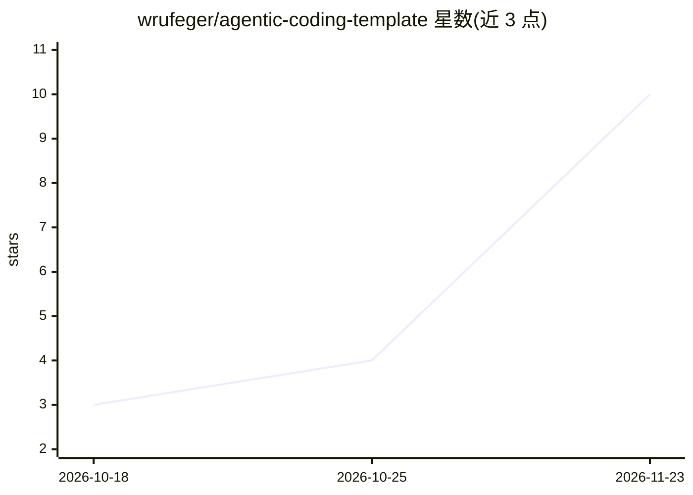

# wrufeger/agentic-coding-template

⭐ 10 · Python · MIT · 推送 2026-11-19 · [GitHub](https://github.com/wrufeger/agentic-coding-template) · [官网](https://wrufeger.github.io/agentic-coding-template-docs/) · 个人维护

**AI 编码助手的项目模板：规则、技能、子代理与强制钩子**

面向 AI 编码助手的工程化项目模板：内置 20 余个日常开发技能（想法转任务、缺陷修复先写失败测试、重构、性能、依赖更新、发布、PR 等）与 9 个子代理角色，各角色配置独立的模型与投入档位。项目状态（配置、规则、任务、日志）以文件形式存于仓库内，跨会话可接续。在 Claude Code 中钩子在每次操作前强制执行机械性检查（禁写模板层、提交前扫描密钥），其他助手仅以指令方式读取规则。需要 Python 3.9+，可由助手引导安装或用 init.py 脚本手动初始化。

## 筛选速览

| 维度 | 判定 | 备注 |
|---|---|---|
| AI 角色 | `ai-ecosystem` | LLM/agent 周边工具 |
| 许可风险 | `permissive` | MIT |
| 部署形态 | `desktop` | 安装包/桌面程序 |
| 模型依赖 | — | README 未给出锁定关系 |
| 硬件要求 | — | 无带数字的原话,不猜 |
| 安装摩擦 | `low` | 无编译、无系统依赖或容器化 |
| 成熟度 | — | 结构信号不足 |

## 能力要点

- 20+ 技能与 9 个子代理角色，每个角色独立模型与投入档位
- Claude Code 中 hooks 在每次操作前强制执行检查（可设 block/warn/off）
- 项目状态存于 docs/ai/ 目录并随代码版本化，会话间可接续
- 支持 Claude Code、Codex、GitHub Copilot、Cursor、Gemini CLI 及任意助手读取规则

## 适用场景

- 为新项目或已有项目配置结构化的 AI 编码工作流
- 跨会话或跨成员交接开发任务时保留项目状态
- 用钩子强制执行提交前密钥扫描等机械性规范
- 为多种语言栈（Python/TypeScript/Go 等）加载对应编码规则

## 场景标签

`编码 Agent` · 领域:编码与开发

## 证据(README 行号)

> L1: # act — agentic coding template
> L163: |**Claude Code**|`CLAUDE.md`, `.claude/settings.json`, `.claude/skills/`, `.claude/agents/`|everything: rules load
> L167: |**any other assistant**|—|tell it to read `docs/ai/rules.md`; every skill is a plain `SKILL.md` it can follow|

## 星数曲线

2026-10-18 3 → 2026-11-23 10（+7）

---
*卡片 v1 · prompt 1.4 · 生成 2026-11-23 · 置信度 high · 依据 README sha `88bc520d0a4e` · [字段定义](../../DATASET.md)*
