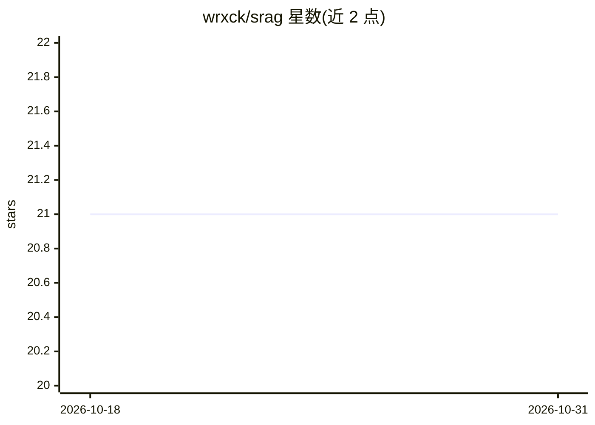

# wrxck/srag

⭐ 21 · Rust · GPL-3.0 · 推送 2026-10-23 · [GitHub](https://github.com/wrxck/srag) · 个人维护

**面向 AI 编码助手的跨项目语义代码检索与 RAG 工具**

用 Rust 编写的语义代码搜索与 RAG 系统：通过 tree-sitter 做 AST 感知分块，SQLite + HNSW 向量索引，查询时执行混合检索（向量+全文、RRF 融合）并重排，支持 9 种语言的 AST 分块与多项目交叉搜索。以 MCP 服务器（stdio/JSON-RPC）接入 Claude Code、Cursor 等 AI 编码工具，提供 9 个检索/分析工具（如 search_code、find_callers、get_project_patterns）。内建提示注入检测与密钥脱敏，支持外部 LLM 提供商（Anthropic/OpenAI）API key 配置，也支持完全本地方案。安装需 Rust 与 Python 3.10+，经 install.sh 构建二进制并配置 Python ML 后端；Windows 仅支持 WSL。GPL-3.0 许可。

## 筛选速览

| 维度 | 判定 | 备注 |
|---|---|---|
| AI 角色 | `ai-ecosystem` | LLM/agent 周边工具 |
| 许可风险 | `viral` | GPL-3.0 |
| 部署形态 | `library` | 以包/库形式分发 |
| 模型依赖 | locked-api |  |
| 硬件要求 | — | 无带数字的原话,不猜 |
| 安装摩擦 | `low` | 无编译、无系统依赖或容器化 |
| 成熟度 | — | 结构信号不足 |

## 能力要点

- tree-sitter AST 感知分块（9 种语言）+ 混合检索（向量+全文、RRF 融合）与重排
- MCP 服务器提供 9 个工具（search_code/find_callers/get_project_patterns 等）供 AI 编码助手调用
- 多项目索引与跨项目语义检索
- 内建提示注入检测与密钥脱污

## 适用场景

- 让 AI 编码助手检索我在多个项目里已有的实现与模式，避免重复造轮子
- 查询自己过去如何处理限流、鉴权等问题，即使不记得项目名或命名
- 检查新代码与既有项目约定的一致性，发现近重复代码

## 场景标签

`RAG` `语义搜索` · 领域:知识与检索

## 证据(README 行号)

> L86: `srag mcp` starts an MCP server over stdio for integration with AI tools (Claude Code, Cursor, etc).
> L92: Now this is where it becomes quite a powerful tool, because not only will your agents be able to find code quicker 
> L124: The Rust CLI handles file discovery, tree-sitter based code chunking, and the SQLite + HNSW vector index. A Python

## 星数曲线

2026-10-18 21 → 2026-10-31 21（+0）

---
*卡片 v1 · prompt 1.4 · 生成 2026-10-28 · 置信度 mid · 依据 README sha `95d12431d8fb` · [字段定义](../../DATASET.md)*
