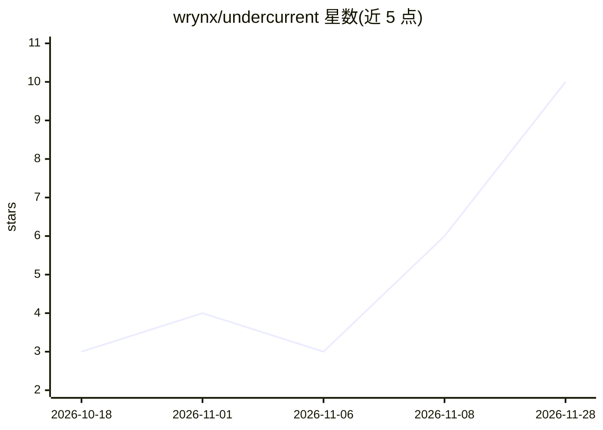

# wrynx/undercurrent

⭐ 10 · Python · Apache-2.0 · 推送 2026-11-27 · [GitHub](https://github.com/wrynx/undercurrent) · [官网](https://wrynx.github.io/undercurrent/) · 组织维护

**为 LLM 推理提供生产级激活探测与在线干预的库**

Undercurrent 是一个 Python 库，在模型生成过程中对内部激活运行探测：YAML 声明式指定捕获的张量、层级与 token 位置；inline 探测在生成路径上可在下一 token 前中止请求；异步探测在旁路队列上运行，不增加响应延迟，可报告到指标、文件或 webhook（含重试、死信与脱敏）。支持 Hugging Face Transformers（含 CPU）与 vLLM 部署（适配器标注为实验性，仅支持 vLLM 0.28）。提供文档、示例工程、CLI 与 Colab 笔记本，API 处于 0.x 阶段可能变更。

## 筛选速览

| 维度 | 判定 | 备注 |
|---|---|---|
| AI 角色 | `ai-ecosystem` | LLM/agent 周边工具 |
| 许可风险 | `permissive` | Apache-2.0 |
| 部署形态 | `library` | 以包/库形式分发 |
| 模型依赖 | local-ok | 支持本地模型 |
| 硬件要求 | `cpu-ok` | |
| 安装摩擦 | `low` | 无编译、无系统依赖或容器化 |
| 成熟度 | `idea` | |

## 能力要点

- YAML 声明式指定激活捕获位置与探测目标，无需改动模型或服务代码
- inline 探测可在生成中途中止请求
- 异步探测走有界队列与溢出策略，输出到指标/文件/webhook sink
- 提供 vLLM 与 Hugging Face Transformers 双引擎适配器

## 适用场景

- 在 vLLM 生产部署中对生成内容做激活级探测并按阈值中止请求
- 在不增加推理延迟的情况下异步观测模型内部激活
- 编写、测试并打包自定义探测器的可解释性工作流

## 场景标签

 · 领域:LLM 基础设施/可解释性与安全

## 证据(README 行号)

> L14: Undercurrent is production-grade activation probing for live LLM inference.
> L45: In short: an engine adapter (Hugging Face or vLLM) captures the activations your
> L64: environment or image, or use `pip install "undercurrent[vllm]"` to get a vLLM

## 星数曲线

2026-10-18 3 → 2026-11-28 10（+7）

---
*卡片 v1 · prompt 1.4 · 生成 2026-11-28 · 置信度 high · 依据 README sha `916c6022db12` · [字段定义](../../DATASET.md)*
