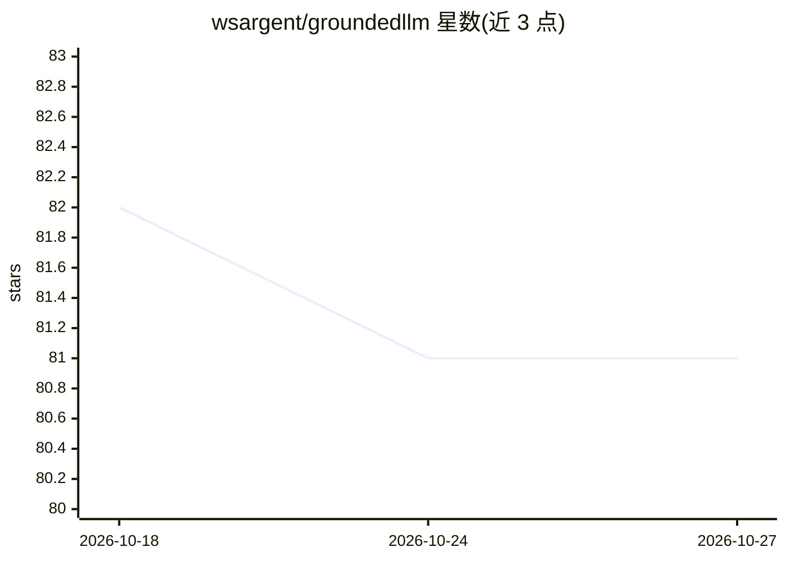

# wsargent/groundedllm

⭐ 81 · Python · MIT · 推送 2026-06-05 · [GitHub](https://github.com/wsargent/groundedllm) · [官网](https://tersesystems.com/blog/2025/04/13/writing-an-llm-that-just-works-for-my-brother/) · 个人维护

**带搜索与抽取工具、可记忆的开箱即用 AI 问答 agent**

基于 Docker Compose 的一体化部署：用 Letta 有状态 agent 框架提供记忆（记住姓名、时区、偏好，跨会话延续对话），配合 Haystack/Hayhooks 的搜索与网页抽取工具为 LLM 提供事实依据，搜索与抽取结果摘要存入归档记忆。默认内置 SearXNG，可选 Linkup/Tavily/Exa/Brave/Jina 等搜索 API；聊天模型配置 OpenAI/Anthropic/Gemini/OpenRouter。前端复用 Open WebUI，可选集成 Google 日历邮件、YouTube 字幕、Zotero、Notion、GitHub 等。需自备 API key，README 明确指出接地搜索可减少但不会消除幻觉。

## 筛选速览

| 维度 | 判定 | 备注 |
|---|---|---|
| AI 角色 | `ai-native` | 本体是模型或模型工具 |
| 许可风险 | `permissive` | MIT |
| 部署形态 | `self-host` | docker 或自建部署 |
| 模型依赖 | locked-api |  |
| 硬件要求 | — | 无带数字的原话,不猜 |
| 安装摩擦 | `low` | 无编译、无系统依赖或容器化 |
| 成熟度 | — | 结构信号不足 |

## 能力要点

- Letta 有状态 agent：跨会话记忆、可教授偏好与搜索策略
- 搜索 + 网页抽取/摘录工具做事实接地
- Docker Compose 一键启动，Open WebUI 前端
- 可选 Zotero/Notion/GitHub/Google 日历邮件/YouTube 字幕等集成

## 适用场景

- 想要一个能搜索取证、少编造的私人 AI 问答助手
- 低门槛体验 Letta 有状态记忆 agent
- 让 agent 结合自己的 Zotero 文献库或 Notion 回答问题

## 场景标签

`AI 助手` · 领域:对话与助手

## 证据(README 行号)

> L3: This is a pre-built, turnkey implementation of an AI agent grounded with search, excerpt, and extract tools to reduc
> L22: This project helps ground your LLM from hallucination by providing it with search and page extraction tools and the

## 星数曲线

2026-10-18 82 → 2026-10-27 81（-1）

---
*卡片 v1 · prompt 1.4 · 生成 2026-10-24 · 置信度 high · 依据 README sha `dc5607941f98` · [字段定义](../../DATASET.md)*
