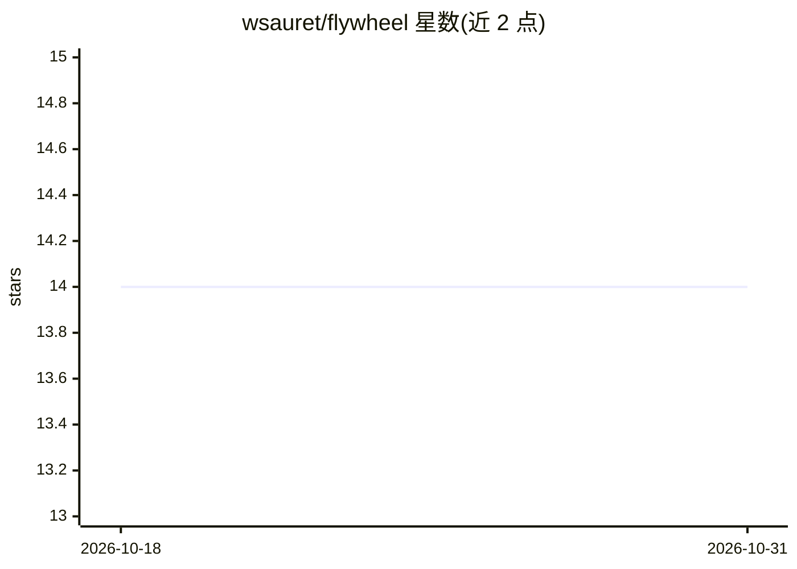

# wsauret/flywheel

⭐ 14 · Shell · MIT · 推送 2026-10-23 · [GitHub](https://github.com/wsauret/flywheel) · 个人维护

**终端 UI 编码 agent：写码、验证、全程可检索回放**

运行于原生终端 UI 的编码 agent：提供 markdown/语法高亮、diff 预览、会话选择器与约四十个内置主题。多步工作流编译为确定性队列，步骤间带验证、重试、暂停恢复与崩溃恢复，支持 CI 无头模式。登录 ChatGPT、GitHub Copilot 等订阅作为模型来源，API key 为回退。会话事件写入本地 SQLite，诊断写入 JSONL，可统一检索。技能与记忆以可审查文件累积。另含面向 Claude Code 的独立插件。以编译好的二进制安装脚本分发，Intel Mac 与 musl Linux 暂不支持。

## 筛选速览

| 维度 | 判定 | 备注 |
|---|---|---|
| AI 角色 | `ai-native` | 本体是模型或模型工具 |
| 许可风险 | `permissive` | MIT |
| 部署形态 | `None` |  |
| 模型依赖 | — | README 未给出锁定关系 |
| 硬件要求 | — | 无带数字的原话,不猜 |
| 安装摩擦 | `low` | 无编译、无系统依赖或容器化 |
| 成熟度 | — | 结构信号不足 |

## 能力要点

- 多步 agent 工作流编译为确定性队列，支持崩溃恢复与 CI 无头运行
- 订阅账号优先、API key 回退的多 provider 接入，多账号自动轮换
- 会话事件源化写入本地 SQLite，`flywheel events search` 统一检索
- 支持 MCP（stdio/HTTP+OAuth），可导入 Claude Code 的 .mcp.json

## 适用场景

- 在终端里让 agent 编写、运行并验证代码
- 在 CI 中无头运行规划-审查-实现-修复工作流
- 接入已有的 ChatGPT/Copilot 订阅做日常编码助手

## 场景标签

`编码 Agent` · 领域:编码与开发

## 证据(README 行号)

> L12: Flywheel is a coding agent that lives in a beautiful native terminal UI. It is a greatest-hits compilation of the b
> L76: The full cycle — plan → review → refine → implement → review → fix — runs as one durable workflow (`/workflow:<id>`

## 星数曲线

2026-10-18 14 → 2026-10-31 14（+0）

---
*卡片 v1 · prompt 1.4 · 生成 2026-10-31 · 置信度 high · 依据 README sha `fce45fec32ff` · [字段定义](../../DATASET.md)*
