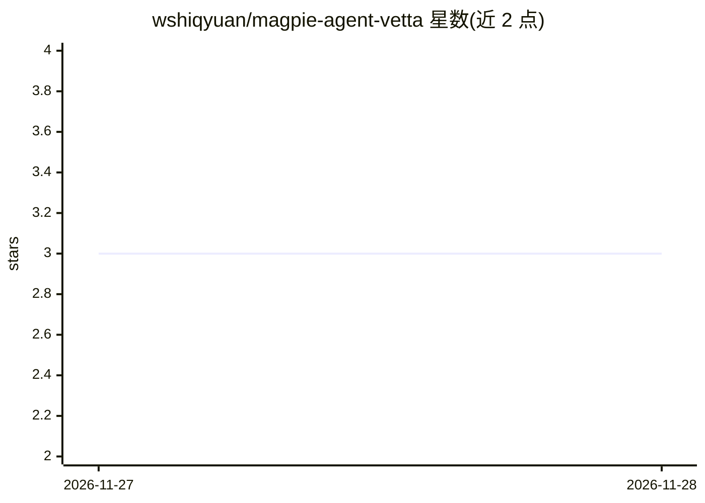

# wshiqyuan/magpie-agent-vetta

⭐ 3 · TypeScript · MIT · 推送 2026-11-25 · [GitHub](https://github.com/wshiqyuan/magpie-agent-vetta) · 个人维护 · 中文 README

**为 Vetta Desktop 提供 Magpie Agent 身份与资源分发的插件**

本仓库是面向 Vetta Desktop 的 Magpie Agent 集成插件：使用 Vetta 官方图标完成身份注册，使 Magpie 可识别来自 Vetta 的请求，并通过 Magpie Library 向 Vetta 分发全局指令（写入 AGENTS.md）、MCP 服务器与 Skills。插件不配置模型账号或接管模型路由，模型连接使用 Vetta 内置的 Magpie Provider。已验证 Windows 环境，macOS/Linux 尚未验证。README 声明该仓库不再维护，由 openvetta 团队的 magpie-vetta 插件替代。

## 筛选速览

| 维度 | 判定 | 备注 |
|---|---|---|
| AI 角色 | `ai-ecosystem` | LLM/agent 周边工具 |
| 许可风险 | `permissive` | MIT |
| 部署形态 | `library` | 以包/库形式分发 |
| 模型依赖 | — | README 未给出锁定关系 |
| 硬件要求 | — | 无带数字的原话,不猜 |
| 安装摩擦 | `low` | 无编译、无系统依赖或容器化 |
| 成熟度 | — | 结构信号不足 |

## 能力要点

- 通过 Magpie Library 向 Vetta 分发全局指令、MCP 服务器和 Skills
- 为 Vetta 注册 User-Agent 专属识别标记
- 沿用 Magpie 的资源分配、冲突处理和撤回机制
- 发布后可在 Magpie 插件发现页搜索安装

## 适用场景

- 让 Magpie 统一管理 Vetta 的 MCP 服务器与 Skills 配置
- 向 Vetta 分发全局指令到 AGENTS.md
- 在 Magpie 中区分来自 Vetta 客户端的请求

## 场景标签

 · 领域:AI 工具/插件集成

## 证据(README 行号)

> L3: 为 Vetta Desktop 提供 Magpie Agent 集成。Magpie 可用 Vetta 的名称和图标识别该 Agent，并通过 Library 向 Vetta 分发全局指令、MCP 服务器和 Skills。
> L13: 该插件只负责 Agent 身份和 Library 资源，不配置模型账号或接管模型路由。请在 Vetta 中使用其内置的 Magpie Provider 配置模型连接。

## 星数曲线

2026-11-27 3 → 2026-11-28 3（+0）

---
*卡片 v1 · prompt 1.4 · 生成 2026-11-27 · 置信度 mid · 依据 README sha `37ecfcde05bf` · [字段定义](../../DATASET.md)*
