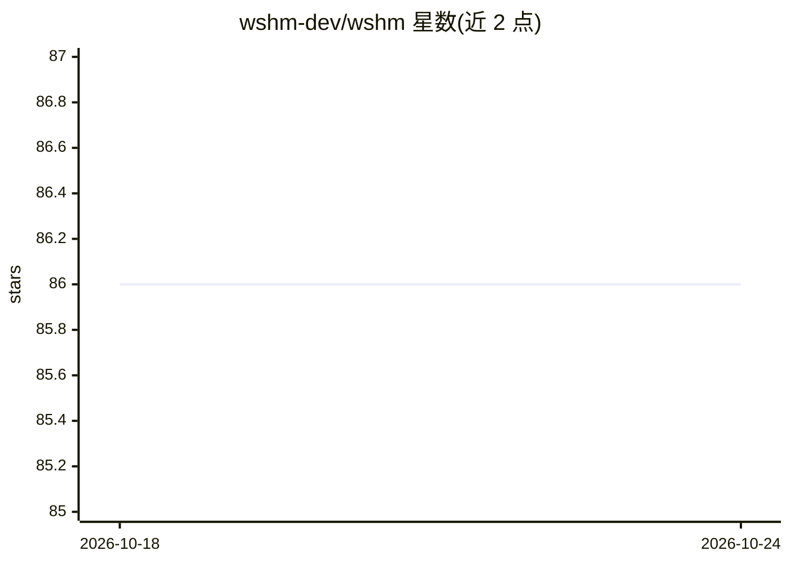

# wshm-dev/wshm

⭐ 86 · Rust · Apache-2.0 · 推送 2026-10-21 · [GitHub](https://github.com/wshm-dev/wshm) · [官网](https://wshm.dev) · 组织维护

**自托管的仓库维护 agent：AI 分诊 issue、分析 PR、管理合并队列**

用 Rust 编写的单一二进制自托管工具，面向 GitHub/GitLab/Gitea/Azure DevOps 仓库维护者：AI 分类打标新 issue、PR 风险分析、评分制合并队列、PR 健康检查（重复/过期/僵尸）、工作流自动化、备份恢复与撤销。提供 CLI、TUI、常驻 daemon 与内嵌 Svelte 网页面板四种界面。支持 14 个 AI 提供商（Anthropic OAuth、OpenAI、本地 Ollama/llama.cpp 等），默认 SQLite、可选 PostgreSQL。Pro 版叠加行级代码审查、issue 自动修复、丰富通知等闭源功能。安装途径含 Homebrew、安装脚本、.deb 与 Windows 直下。

## 筛选速览

| 维度 | 判定 | 备注 |
|---|---|---|
| AI 角色 | `ai-native` | 本体是模型或模型工具 |
| 许可风险 | `permissive` | Apache-2.0 |
| 部署形态 | `desktop` | 安装包/桌面程序 |
| 模型依赖 | local-ok | 支持本地模型 |
| 硬件要求 | — | 无带数字的原话,不猜 |
| 安装摩擦 | `low` | 无编译、无系统依赖或容器化 |
| 成熟度 | — | 结构信号不足 |

## 能力要点

- AI 分诊新 issue：分类、优先级、置信度评分、自动打标
- PR 风险分析（低/中/高）与评分制合并队列自动合并
- 14 个 AI 提供商可选，含本地 Ollama/llama.cpp 与 Claude 订阅 OAuth 登录
- 四种界面（CLI/TUI/daemon/Web 面板）均包含在开源版

## 适用场景

- 自动分诊和打标堆积的 issue 积压
- 评估 PR 合并风险并按评分自动合并
- 在自有服务器上接入本地或自有 AI key 运行仓库自动化

## 场景标签

 · 领域:开发运维/仓库自动化

## 证据(README 行号)

> L7: **Five tools in one binary.** AI code review, merge queue, issue auto-fix, workflow automation, and triage — all in 
> L130: - **Issue triage** — AI classification (bug/feature/question/etc.), priority, confidence scoring, auto-labeling
> L143: - **14 AI providers** — Anthropic, OpenAI, Google, Mistral, Groq, DeepSeek, xAI, Ollama (local), llama.cpp, and mo

## 星数曲线

2026-10-18 86 → 2026-10-24 86（+0）

---
*卡片 v1 · prompt 1.4 · 生成 2026-10-24 · 置信度 high · 依据 README sha `b5ec9c7b2c0f` · [字段定义](../../DATASET.md)*
