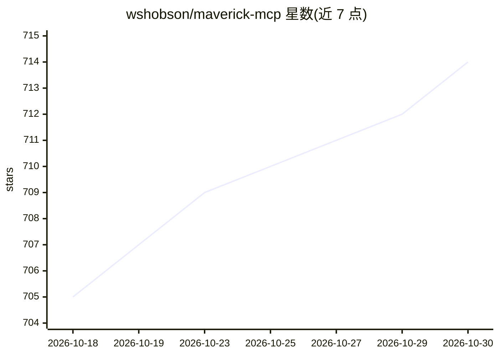

# wshobson/maverick-mcp

⭐ 714 · Python · MIT · 推送 2026-10-26 · [GitHub](https://github.com/wshobson/maverick-mcp) · [官网](https://sethhobson.com) · 个人维护

**本地运行的股票市场 MCP 服务器：行情、技术分析、组合与回测**

开源 MCP 服务器，把 Yahoo Finance 数据（经 yfinance）接入 AI 助手：38 个核心工具覆盖行情报价、历史价格、基本面、RSI/MACD、支撑阻力与选股筛选；另有 12 个可选回测工具（含 ML 策略与蒙特卡洛模拟）和 3 个可选研究工具（需配置 LLM 与网络搜索）。支持投资组合记录、观察列表与交易日志，数据存于本地 SQLite。核心工具无需 API key。仅教育与信息用途，不下单、不提供投资建议；历史数据支持美股及 .L/.T/.TO/.AX/.HK/.DE 后缀。

## 筛选速览

| 维度 | 判定 | 备注 |
|---|---|---|
| AI 角色 | `ai-ecosystem` | LLM/agent 周边工具 |
| 许可风险 | `permissive` | MIT |
| 部署形态 | `self-host` | docker 或自建部署 |
| 模型依赖 | — | README 未给出锁定关系 |
| 硬件要求 | — | 无带数字的原话,不猜 |
| 安装摩擦 | `low` | 无编译、无系统依赖或容器化 |
| 成熟度 | — | 结构信号不足 |

## 能力要点

- 38 个核心工具：行情、基本面、RSI/MACD、支撑阻力与三类选股筛选
- 12 个可选回测工具（含随机森林 ML 策略、蒙特卡洛、市场状态检测）
- 投资组合、观察列表与交易日志存储于本地 SQLite/可选 PostgreSQL
- 核心工具无需 API key，HTTP 端点默认仅绑定 127.0.0.1

## 适用场景

- 在 Claude Desktop、Cursor 等 MCP 客户端中查询股票行情与技术指标
- 跟踪投资组合、观察列表并记录交易日志
- 用历史数据回测并比较多组交易策略

## 场景标签

`金融量化` · 领域:学习与行业

## 证据(README 行号)

> L13: MCP means Model Context Protocol, the standard that lets an AI assistant call
> L67: uv run --directory /absolute/path/to/maverick-mcp maverick-mcp --transport stdio

## 星数曲线

2026-10-18 705 → 2026-10-30 714（+9）

---
*卡片 v1 · prompt 1.4 · 生成 2026-10-22 · 置信度 mid · 依据 README sha `fc1d1e765ed4` · [字段定义](../../DATASET.md)*
