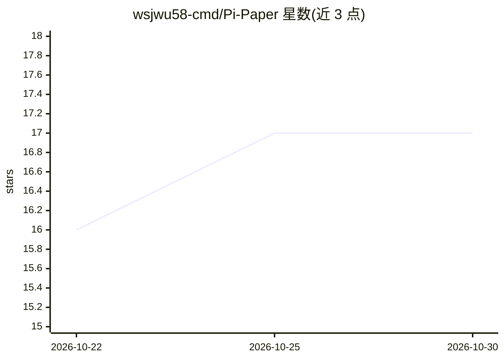

# wsjwu58-cmd/Pi-Paper

⭐ 17 · TypeScript · MIT · 推送 2026-10-24 · [GitHub](https://github.com/wsjwu58-cmd/Pi-Paper) · [官网](https://wsjaly.cn/) · 个人维护 · 中文 README

**单用户本地优先的 AI 桌面画布创作工具**

基于 Electron 的桌面创作应用：在无限画布上连接文本、图像、视频、音频六类节点，由小P（Xiaop）Agent 经本地工具网关修改画布并执行多模态生成任务，单个与批量生成均需用户确认。支持本地项目管理、素材库、短剧制作、会话与记忆、分组画布组织。用户在 API 配置页填写云端提供方凭据（设备加密保存），也可接本地文本端点（仅 loopback）。当前为开发预发布版，Windows 包未签名、macOS 未公证；本地视频合成需 FFmpeg。

## 筛选速览

| 维度 | 判定 | 备注 |
|---|---|---|
| AI 角色 | `ai-native` | 本体是模型或模型工具 |
| 许可风险 | `permissive` | MIT |
| 部署形态 | `desktop` | 安装包/桌面程序 |
| 模型依赖 | — | README 未给出锁定关系 |
| 硬件要求 | — | 无带数字的原话,不猜 |
| 安装摩擦 | `low` | 无编译、无系统依赖或容器化 |
| 成熟度 | `idea` | |

## 能力要点

- 无限画布六类节点：连接、连线规则、自动保存、JSON 导入导出
- 小P Agent 感知画布的对话与受控工具调用（生成需确认、幂等恢复）
- 多平台安装包（exe/DMG×2/AppImage/DEB）与 Docker/noVNC 运行方式
- 本地文本端点仅允许 loopback 地址，当前未声明支持 Agent 工具调用

## 适用场景

- 在本地无限画布上组织参考素材并让 Agent 协助生成与合成短剧
- 以节点流程串联文本、图像、视频、音频的生成与编辑
- 无需平台登录，在个人桌面环境管理 AI 创作项目与任务历史

## 场景标签

`多模态` · 领域:感知与多模态

## 证据(README 行号)

> L13: Pi-Paper 是一款面向单用户的桌面创作工具。在无限画布上连接文本、图像、视频、音频和创作笔记，与小P（Xiaop）Agent 一起将想法转化为可编辑的创作流程。
> L55: |多模态生成|通过已实现的模型绑定执行文本、图像、视频、音频和合成任务；任务状态与具体失败原因在对应节点展示|

## 星数曲线

2026-10-22 16 → 2026-10-30 17（+1）

---
*卡片 v1 · prompt 1.4 · 生成 2026-10-29 · 置信度 high · 依据 README sha `a9432f6f0cb4` · [字段定义](../../DATASET.md)*
