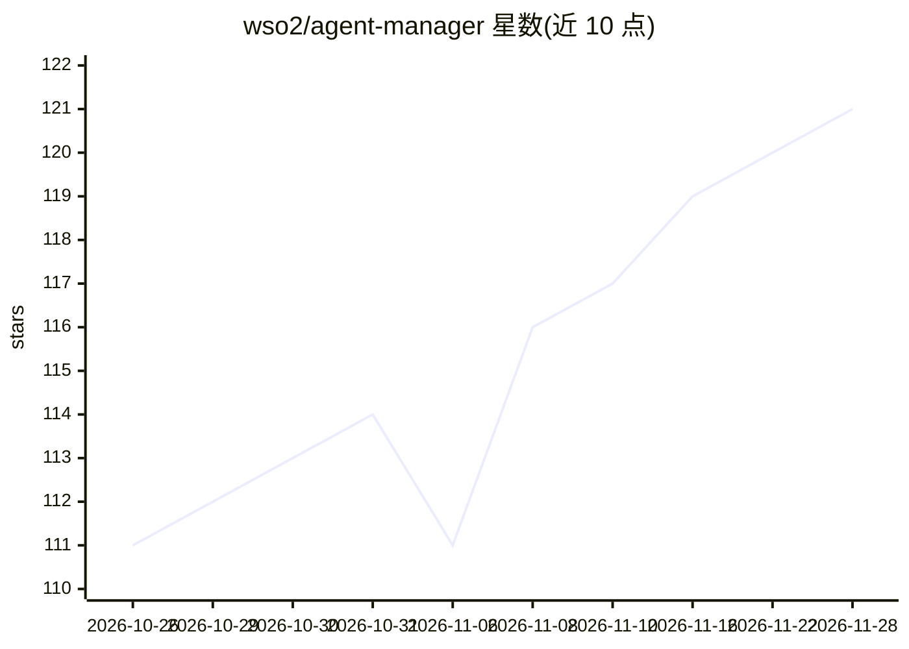

# wso2/agent-manager

⭐ 121 · Go · Apache-2.0 · 推送 2026-11-27 · [GitHub](https://github.com/wso2/agent-manager) · [官网](https://wso2.github.io/agent-manager/) · 组织维护

**企业级 AI Agent 部署管理与治理的开放控制平面**

WSO2 Agent Manager 为企业提供 AI agent 管理平台：支持在 Kubernetes 上以生产级配置部署内部托管的 agent，同时可纳管外部已部署的 agent；通过统一控制面管理 agent 版本、配置与部署生命周期，强制执行治理策略与访问控制，并基于 OpenTelemetry 提供跨多个 AI 框架的零代码改动自动插桩与全栈可观测（traces/metrics/logs）。平台构建于 OpenChoreo 之上，由插桩包、控制台、后端 API、trace 查询 API 及 Kubernetes init container 等组件组成，通过 Helm charts 部署。

## 筛选速览

| 维度 | 判定 | 备注 |
|---|---|---|
| AI 角色 | `ai-ecosystem` | LLM/agent 周边工具 |
| 许可风险 | `permissive` | Apache-2.0 |
| 部署形态 | `library` | 以包/库形式分发 |
| 模型依赖 | — | README 未给出锁定关系 |
| 硬件要求 | — | 无带数字的原话,不猜 |
| 安装摩擦 | `low` | 无编译、无系统依赖或容器化 |
| 成熟度 | — | 结构信号不足 |

## 能力要点

- 在 Kubernetes 上部署并运行 AI agent，统一控制面管理版本与配置
- 基于 OpenTelemetry 的自动插桩，零代码改动接入多个 AI 框架
- 支持纳管外部已部署 agent 与内部 agent 的统一治理
- 提供 Helm charts 与多组件架构（console/API/trace observer）

## 适用场景

- 企业在大规模部署内部 AI agent 时进行统一生命周期管理
- 对内部与外部 agent 实施治理策略和访问控制
- 对多框架 agent 进行全链路追踪、指标与日志观测

## 场景标签

`LLM 可观测性` · 领域:评测与运维

## 证据(README 行号)

> L7: An open control plane designed for enterprises to deploy, manage, and govern AI agents at scale.
> L11: WSO2 Agent Manager provides a comprehensive platform for enterprise AI agent management. It enables organizations t
> L18: - **Lifecycle Management** - Manage agent versions, configurations, and deployments from a unified control plane

## 星数曲线

2026-10-26 111 → 2026-11-28 121（+10）

---
*卡片 v1 · prompt 1.4 · 生成 2026-11-28 · 置信度 high · 依据 README sha `e3daca4dd092` · [字段定义](../../DATASET.md)*
