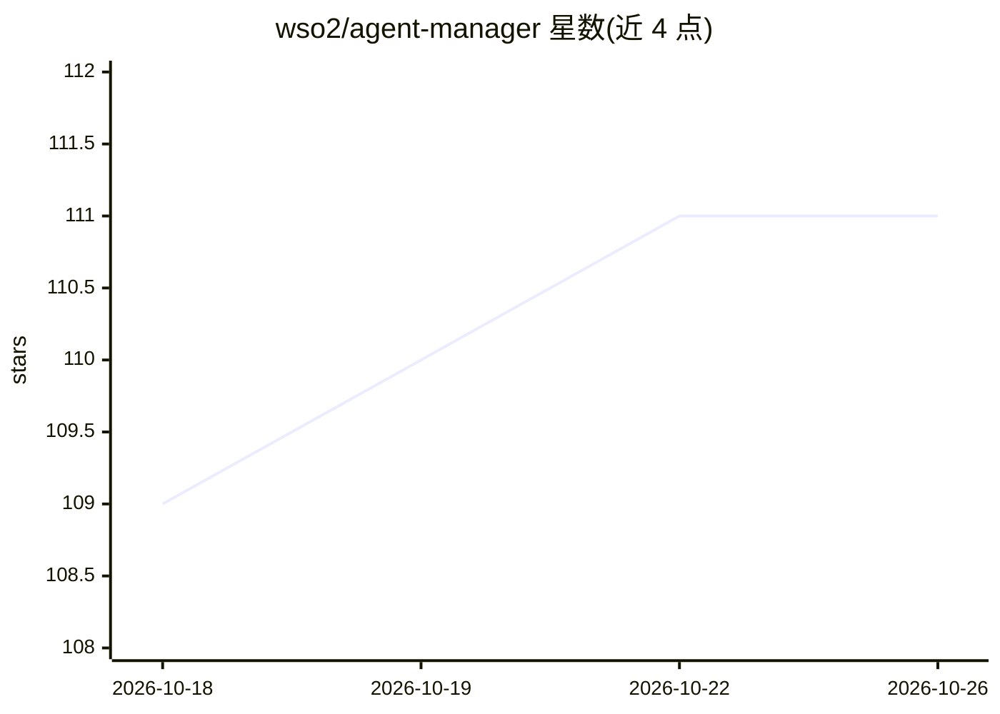

# wso2/agent-manager

⭐ 111 · Go · Apache-2.0 · 推送 2026-10-23 · [GitHub](https://github.com/wso2/agent-manager) · [官网](https://wso2.github.io/agent-manager/) · 组织维护

**企业级 AI agent 控制平面：大规模部署、治理与可观测**

WSO2 维护的开源控制平面，面向企业部署内部托管或外部部署的 AI agent：在 Kubernetes 上运行 agent、统一管理版本与配置、执行治理策略与访问控制，并通过 OpenTelemetry 自动插桩采集 trace、指标与日志实现全栈可观测。内部部署基于 OpenChoreo，插桩组件支持多 AI 框架零代码接入。由 amp-instrumentation、amp-console、amp-api、amp-trace-observer 等五个组件构成，通过 Helm chart 在 Kubernetes 上安装。

## 筛选速览

| 维度 | 判定 | 备注 |
|---|---|---|
| AI 角色 | `ai-ecosystem` | LLM/agent 周边工具 |
| 许可风险 | `permissive` | Apache-2.0 |
| 部署形态 | `library` | 以包/库形式分发 |
| 模型依赖 | — | README 未给出锁定关系 |
| 硬件要求 | — | 无带数字的原话,不猜 |
| 安装摩擦 | `low` | 无编译、无系统依赖或容器化 |
| 成熟度 | — | 结构信号不足 |

## 能力要点

- Kubernetes 上部署并运行 AI agent 的生产就绪配置
- OpenTelemetry 自动插桩，AI 框架零代码改动接入
- 统一控制平面管理 agent 版本、配置与治理策略
- 支持同时监控内部与外部部署的 agent

## 适用场景

- 企业集中部署和管理多个 AI agent
- 对 agent 行为做 trace/指标/日志的全栈可观测
- 跨 agent 统一执行治理策略与访问控制

## 场景标签

`LLM 可观测性` · 领域:评测与运维

## 证据(README 行号)

> L7: An open control plane designed for enterprises to deploy, manage, and govern AI agents at scale.
> L11: WSO2 Agent Manager provides a comprehensive platform for enterprise AI agent management. It enables organizations t

## 星数曲线

2026-10-18 109 → 2026-10-26 111（+2）

---
*卡片 v1 · prompt 1.4 · 生成 2026-10-23 · 置信度 high · 依据 README sha `5fded7c653d3` · [字段定义](../../DATASET.md)*
