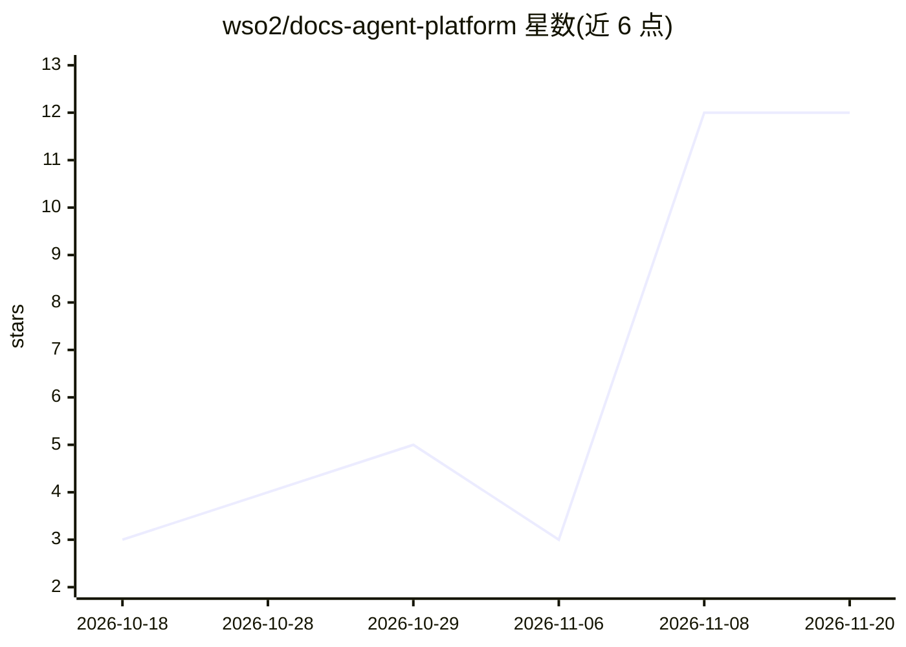

# wso2/docs-agent-platform

⭐ 12 · MDX · Apache-2.0 · 推送 2026-11-14 · [GitHub](https://github.com/wso2/docs-agent-platform) · [官网](https://wso2.com/agent-platform/docs/) · 组织维护

**WSO2 Agent Manager 平台的文档源仓库**

WSO2 Agent Manager Platform 文档站点的源代码仓库，以文档站形式提供。README 中未描述平台本身的功能、架构或使用方式，仅说明仓库使用 npm `overrides` 机制固定传递依赖的补丁版本，其中对 `mermaid` 依赖的 `katex` 版本设置了上限，原因是 KaTeX 0.18.5 及之后版本引入的 CLI 依赖要求 Node.js 22.12+，而该文档站支持 Node.js 20。

## 筛选速览

| 维度 | 判定 | 备注 |
|---|---|---|
| AI 角色 | `ai-knowledge` | 知识聚合/清单类 |
| 许可风险 | `permissive` | Apache-2.0 |
| 部署形态 | `None` |  |
| 模型依赖 | — | README 未给出锁定关系 |
| 硬件要求 | — | 无带数字的原话,不猜 |
| 安装摩擦 | `low` | 无编译、无系统依赖或容器化 |
| 成熟度 | — | 结构信号不足 |

## 能力要点

- WSO2 Agent Manager Platform 文档站的源仓库
- 使用 npm overrides 固定传递依赖补丁版本
- 对 katex 设置版本上限以兼容 Node.js 20

## 适用场景

- 查看或贡献 WSO2 Agent Manager 平台文档
- 在 Node.js 20 环境下构建该文档站点

## 场景标签

 · 领域:文档

## 证据(README 行号)

> L2: Source repository for WSO2 Agent Manager Platform documentation
> L6: `package.json` uses npm `overrides` to pin patched versions of transitive dependencies. One of them is a deliberate 

## 星数曲线

2026-10-18 3 → 2026-11-20 12（+9）

---
*卡片 v1 · prompt 1.4 · 生成 2026-11-18 · 置信度 mid · 依据 README sha `f7e2c10f0cb2` · [字段定义](../../DATASET.md)*
