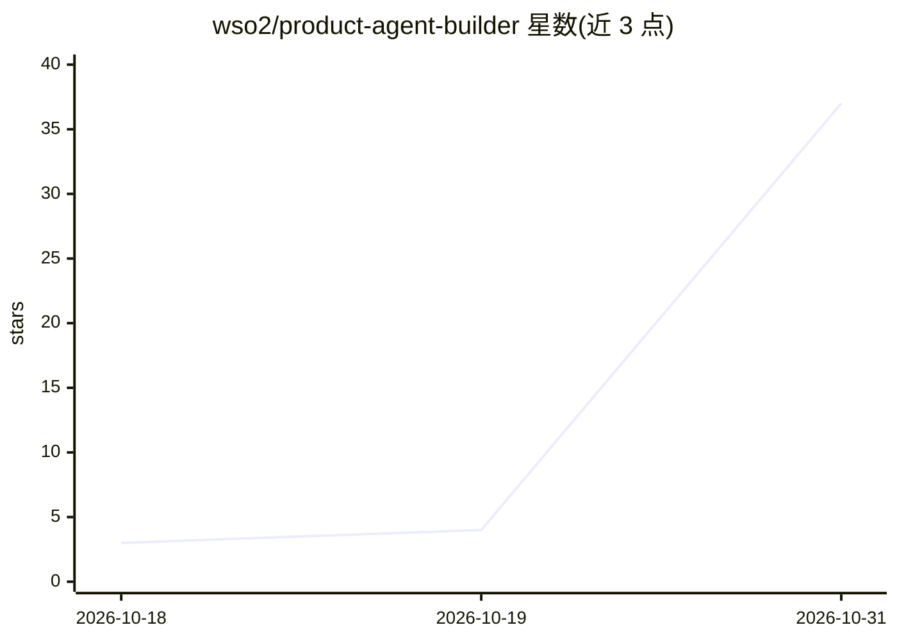

# wso2/product-agent-builder

⭐ 37 · Apache-2.0 · 推送 2026-10-30 · [GitHub](https://github.com/wso2/product-agent-builder) · 组织维护

**面向开发者的开源低代码 AI agent 构建 IDE**

WSO2 维护的开源低代码 IDE，用于构建 AI agent：可视化连接触发器（chat/WhatsApp/Slack）、模型、记忆与工具，或用 Ballerina 代码编写，图与代码双向同步。支持多 agent 系统、可暂停/恢复的 durable agent、向量知识库作为工具、从 OpenAPI 规范生成 MCP server、离线评估，以及自建 Copilot 辅助构建。提供 macOS/Windows/Linux 安装包；本仓库仅承载发布与 issue 跟踪，源码在其他仓库。

## 筛选速览

| 维度 | 判定 | 备注 |
|---|---|---|
| AI 角色 | `ai-ecosystem` | LLM/agent 周边工具 |
| 许可风险 | `permissive` | Apache-2.0 |
| 部署形态 | `desktop` | 安装包/桌面程序 |
| 模型依赖 | — | README 未给出锁定关系 |
| 硬件要求 | — | 无带数字的原话,不猜 |
| 安装摩擦 | `low` | 无编译、无系统依赖或容器化 |
| 成熟度 | — | 结构信号不足 |

## 能力要点

- 可视化 agent 设计器与 Ballerina 代码双向同步
- durable agent：暂停/恢复、等待外部事件、故障后不丢失进度
- 从 OpenAPI 规范生成 MCP server，并可发布到自托管 Agent Manager
- 离线评估，Copilot 可生成评估数据集并协助修复失败项

## 适用场景

- 用低代码方式搭建并部署 AI agent
- 把 agent 接入 chat、WhatsApp、Slack 等触发渠道
- 构建多 agent 协作与带知识库的问答系统
- 在统一界面内运行、追踪和评估 agent

## 场景标签

`Agent 框架` `多智能体` · 领域:Agent 开发

## 证据(README 行号)

> L9: WSO2 Agent Builder is an open source, low-code IDE for building AI agents. Design an agent visually by connecting tr
> L15: - **Visual agent designer** – Connect triggers such as chat, WhatsApp and Slack to an agent, then give it a model, 

## 星数曲线

2026-10-18 3 → 2026-10-31 37（+34）

---
*卡片 v1 · prompt 1.4 · 生成 2026-10-30 · 置信度 high · 依据 README sha `08b6bd5a0e95` · [字段定义](../../DATASET.md)*
