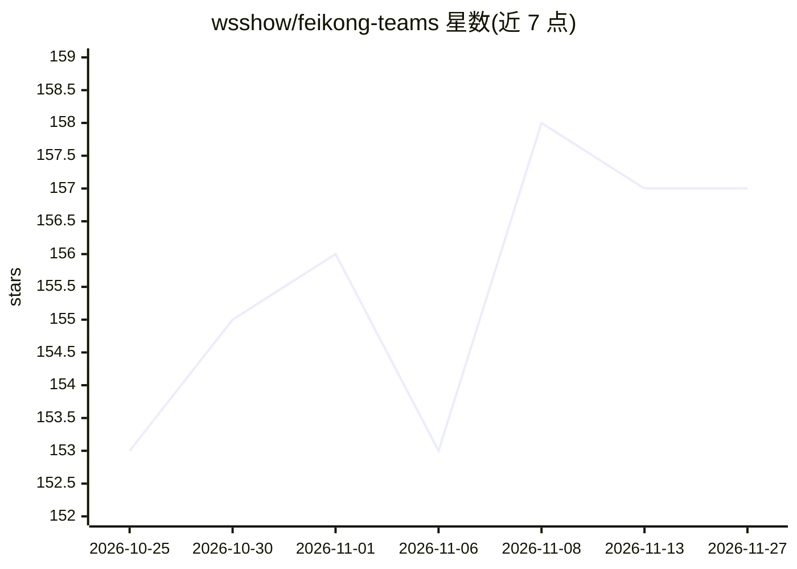

# wsshow/feikong-teams

⭐ 157 · Go · MIT · 推送 2026-11-13 · [GitHub](https://github.com/wsshow/feikong-teams) · [官网](https://fkteams.wsshow.top) · 个人维护 · 中文 README

**本地运行的多智能体协作 AI 助手，面向开发者长任务**

fkteams（非空小队）是一个可本地运行的开源多智能体协作 AI 助手，覆盖软件开发、资料研究、数据分析、远程运维与自动化任务。协调者按任务调度代码、研究、分析、运维等专业智能体，提供团队、深度和圆桌讨论三种模式。入口包括 Web UI、CLI/TUI、API 服务及 Discord、QQ、微信消息通道；内置文件、命令、搜索、Git、SSH 等工具，可通过 MCP、Skills、JavaScript 与自定义智能体扩展。面向长任务支持后台执行、断线恢复与续问队列，数据默认存本地并提供权限策略与执行审计。提供一键安装脚本、Docker 镜像与源码构建（需 Go 和 Bun）。

## 筛选速览

| 维度 | 判定 | 备注 |
|---|---|---|
| AI 角色 | `ai-ecosystem` | LLM/agent 周边工具 |
| 许可风险 | `permissive` | MIT |
| 部署形态 | `None` |  |
| 模型依赖 | — | README 未给出锁定关系 |
| 硬件要求 | — | 无带数字的原话,不猜 |
| 安装摩擦 | `low` | 无编译、无系统依赖或容器化 |
| 成熟度 | — | 结构信号不足 |

## 能力要点

- 协调者调度多个专业智能体，支持团队/深度/圆桌讨论三种模式
- Web、CLI、API 与 Discord、QQ、微信多入口复用会话与执行能力
- 内置文件、命令、搜索、Git、SSH 等工具，可经 MCP/Skills/JavaScript 扩展
- 长任务支持后台执行、断线恢复、续问队列与工具调用审计

## 适用场景

- 在终端工作流中交办代码开发与远程运维任务
- 搭建 Discord/QQ/微信机器人常驻助手
- 让多智能体以圆桌讨论方式完成复杂分析
- 通过 API 服务把智能体能力集成进自动化流程

## 场景标签

`多智能体` `AI 助手` `聊天机器人` `数据分析` · 领域:Agent 开发

## 证据(README 行号)

> L8:  一个可本地运行的开源多智能体协作 AI 助手，面向软件开发、资料研究、数据分析、远程运维和自动化任务，并通过 Web、CLI、API 与消息通道提供一致的长任务体验。
> L14: - **真正的多智能体协作**：协调者按任务调度代码、研究、分析、远程运维等专业智能体，支持团队、深度和圆桌讨论模式。

## 星数曲线

2026-10-25 153 → 2026-11-27 157（+4）

---
*卡片 v1 · prompt 1.4 · 生成 2026-11-27 · 置信度 high · 依据 README sha `63ec35016f3b` · [字段定义](../../DATASET.md)*
