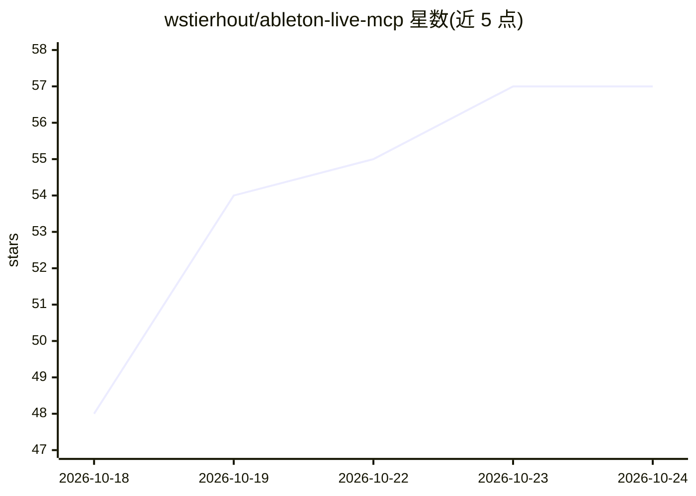

# wstierhout/ableton-live-mcp

⭐ 57 · Python · MIT · 推送 2026-09-17 · [GitHub](https://github.com/wstierhout/ableton-live-mcp) · [官网](https://abletonmcp.com) · 个人维护

**让 AI 助手通过 MCP 控制 Ableton Live 的本地服务器**

基于 Model Context Protocol 的本地服务器，向 Claude、Cursor、Codex 等 MCP 客户端提供 156 个类型化工具，用于在运行中的 Ableton Live 里建轨、编辑 MIDI、加载乐器效果器、混音和母带处理。机制：一个运行在 Live 内的 Remote Script 通过本地 socket（127.0.0.1:9877，无鉴权）暴露 Live API，服务器转为带参数校验和读写提示的工具；另有离线工具可读取与 diff 已保存的 .als/.adg/.adv 文件。需 Ableton Live 11/12、Python 3.10+、uv；部分工具会做破坏性编辑；Live API 不支持导出/冻结操作。

## 筛选速览

| 维度 | 判定 | 备注 |
|---|---|---|
| AI 角色 | `ai-ecosystem` | LLM/agent 周边工具 |
| 许可风险 | `permissive` | MIT |
| 部署形态 | `None` |  |
| 模型依赖 | locked-api |  |
| 硬件要求 | — | 无带数字的原话,不猜 |
| 安装摩擦 | `low` | 无编译、无系统依赖或容器化 |
| 成熟度 | — | 结构信号不足 |

## 能力要点

- 156 个类型化工具，带参数校验、读写提示与 5 个工作流 prompt
- Live 内 Remote Script 经本地 socket 暴露 Live API
- 离线读取/diff/lint .als 项目与 .adg/.adv rack 文件
- 内置鼓组样式、和弦进行、旋律与贝斯线等音乐生成器，支持 ABLETON_TOOLSETS 按组加载工具

## 适用场景

- 在 Claude/Cursor/Codex 中用自然语言指挥 Ableton Live 建轨、编 MIDI、混音
- 不启动 Live 时检查、diff 已保存的 .als 工程
- 本地分析音频文件的峰值/RMS 并扫描混音问题

## 场景标签

 · 领域:音乐制作/AI 工具集成

## 证据(README 行号)

> L11: Control Ableton Live from an AI assistant. This is a Model Context Protocol (MCP)
> L17: A Remote Script runs inside Live and exposes the Live API over a local socket. The

## 星数曲线

2026-10-18 48 → 2026-10-24 57（+9）

---
*卡片 v1 · prompt 1.4 · 生成 2026-10-24 · 置信度 high · 依据 README sha `ec44feae95e3` · [字段定义](../../DATASET.md)*
