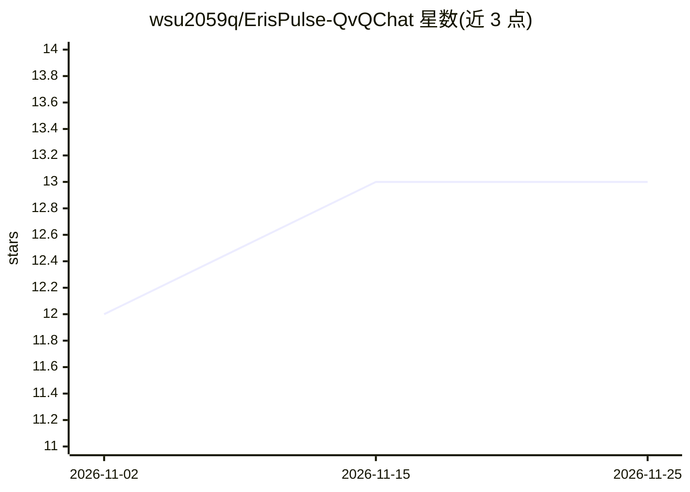

# wsu2059q/ErisPulse-QvQChat

⭐ 13 · Python · MIT · 推送 2026-11-23 · [GitHub](https://github.com/wsu2059q/ErisPulse-QvQChat) · 个人维护 · 中文 README

**给 ErisPulse 机器人装上 AI 智能体的模块：工具循环/记忆/定时任务**

ErisPulse 框架的智能体模块，安装后使聊天机器人具备自然语言对话、工具调用、代码执行、长期记忆与定时任务能力。提供网页控制台管理模型池、人格、知识库、技能、MCP、会话与审计；对话页支持流式输出与工具调用展示。模型池接入任意 OpenAI 兼容接口，支持故障转移与用量记录；生态模块声明的 service 自动注册为智能体工具。要求 Python 3.10+、ErisPulse >= 2.8.0 及至少一个平台适配器。

## 筛选速览

| 维度 | 判定 | 备注 |
|---|---|---|
| AI 角色 | `ai-native` | 本体是模型或模型工具 |
| 许可风险 | `permissive` | MIT |
| 部署形态 | `self-host` | docker 或自建部署 |
| 模型依赖 | — | README 未给出锁定关系 |
| 硬件要求 | — | 无带数字的原话,不猜 |
| 安装摩擦 | `low` | 无编译、无系统依赖或容器化 |
| 成熟度 | — | 结构信号不足 |

## 能力要点

- 工具循环覆盖消息、平台 API、文件、Python 执行、记忆、知识库与定时任务
- ErisPulse 生态模块声明的 service 自动注册为智能体工具
- 模型池支持任意 OpenAI 兼容接口，含故障转移与用量记录
- 提供 OpenAI 兼容端点 /v1/models 与 /v1/chat/completions（含流式）

## 适用场景

- 给 OneBot 等平台的聊天机器人添加 AI 对话与工具调用能力
- 通过自然语言管理 VPS 等接入的服务
- 在群聊中按触发规则运行带人格与记忆的机器人
- 用自然语言创建 cron/at 定时任务

## 场景标签

`聊天机器人` · 领域:对话与助手

## 证据(README 行号)

> L5: **给 bot 装个 AI 智能体 —— 自然语言聊天 / 工具循环 / 代码执行 / 长期记忆 / 定时任务。**
> L24: ErisPulse 的智能体模块：装上之后 bot 就是个带工具的 AI。对话页流式输出，工具调用逐步展示，可中止运行中的任务；管理页覆盖模型池、人格、知识库、技能、工具、MCP、定时任务、记忆、会话、审计与存储。另提供 Open

## 星数曲线

2026-11-02 12 → 2026-11-25 13（+1）

---
*卡片 v1 · prompt 1.4 · 生成 2026-11-18 · 置信度 high · 依据 README sha `76e2bbfcc4ff` · [字段定义](../../DATASET.md)*
