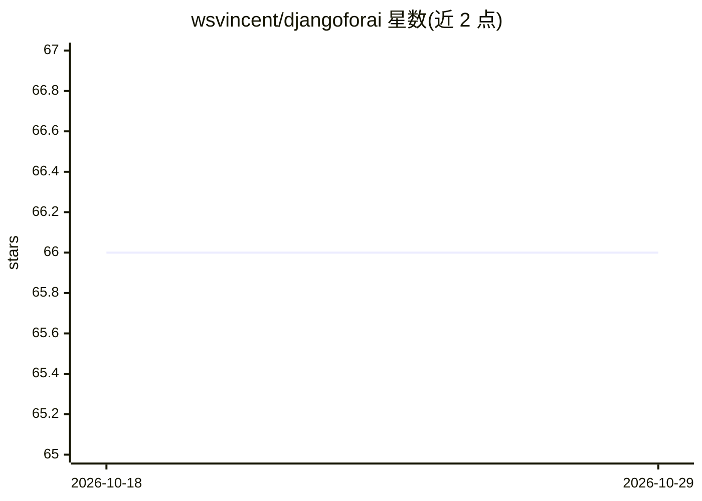

# wsvincent/djangoforai

⭐ 66 · Python · 推送 2025-11-13 · [GitHub](https://github.com/wsvincent/djangoforai) · 个人维护

**Django + Ollama + SSE + HTMX 的本地 LLM 流式聊天演示应用**

基于 Django、HTMX 与 Server-Sent Events 构建的实时流式聊天应用，通过 Ollama 集成本地 LLM（默认 Gemma 3:4B，约 3.3GB），提供 Markdown 渲染与语法高亮、对话历史与上下文管理，历史记录可在首页和 Django admin 中访问。该项目为 DjangoCon US 2025 演讲的配套演示，安装依赖 Ollama 桌面端与 uv 包管理器，通过 uv run 执行迁移与启动。

## 筛选速览

| 维度 | 判定 | 备注 |
|---|---|---|
| AI 角色 | `ai-native` | 本体是模型或模型工具 |
| 许可风险 | `none` | — |
| 部署形态 | `None` |  |
| 模型依赖 | local-ok | 支持本地模型 |
| 硬件要求 | — | 无带数字的原话,不猜 |
| 安装摩擦 | `low` | 无编译、无系统依赖或容器化 |
| 成熟度 | — | 结构信号不足 |

## 能力要点

- SSE 实时流式输出 LLM 回答
- 经 Ollama 集成本地 LLM（默认 gemma3:4b）
- Markdown 渲染与语法高亮、对话历史管理
- Django admin 中可查看历史会话

## 适用场景

- 学习 Django + HTMX + SSE 实现流式聊天的做法
- 在本地跑一个不依赖外部 API 的聊天界面
- 作为 DjangoCon 演讲的配套代码跟随学习

## 场景标签

`聊天机器人` `教程课程` · 领域:对话与助手

## 证据(README 行号)

> L3: A real-time streaming chat application built with Django, HTMX, and Server-Sent Events (SSE) to mimic popular LLMs l
> L11: - 🚀 Real-time streaming responses using Server-Sent Events (SSE)
> L12: - 🤖 Local LLM integration via Ollama (Gemma 3:4B)

## 星数曲线

2026-10-18 66 → 2026-10-29 66（+0）

---
*卡片 v1 · prompt 1.4 · 生成 2026-10-24 · 置信度 high · 依据 README sha `0c8741406e6d` · [字段定义](../../DATASET.md)*
