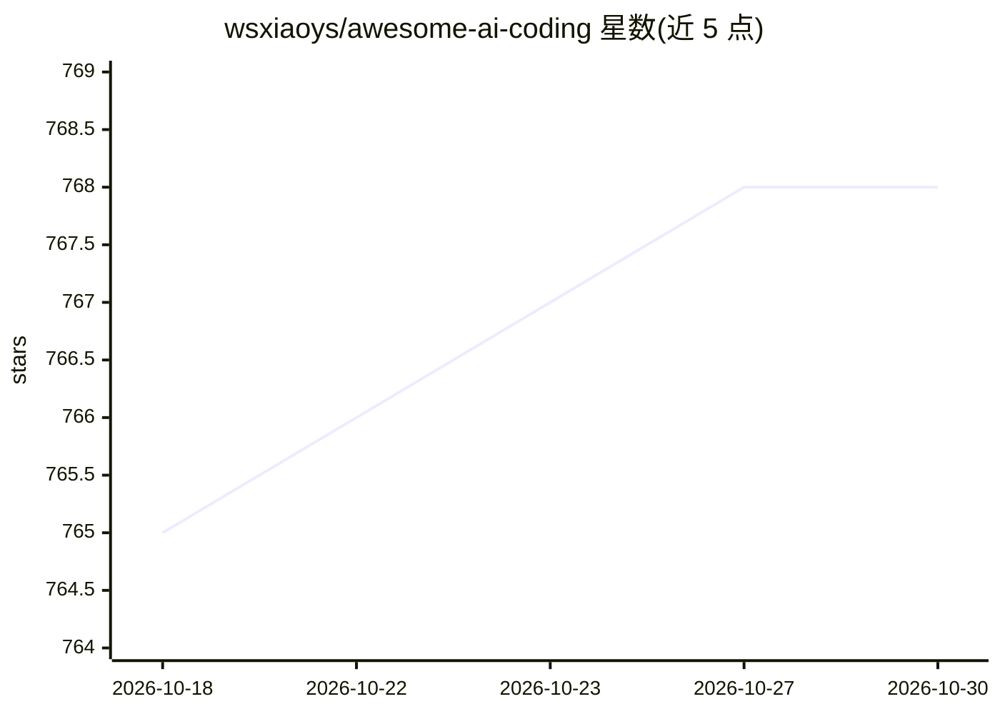

# wsxiaoys/awesome-ai-coding

⭐ 768 · CC0-1.0 · 推送 2026-03-02 · [GitHub](https://github.com/wsxiaoys/awesome-ai-coding) · 个人维护

**AI 编程主题资源清单：项目/数据集/模型/论文/产品聚合**

一个 awesome 风格的策展清单，收录 AI 编程相关资源并分类组织：Projects（约 25 个开源项目，如 Tabby、Twinny、PraisonAI）、数据集（The Pile、The Stack 等）、代码 LLM 与嵌入模型列举、论文博客摘录（含 arXiv 链接与要点）、商业产品与初创公司列表（Copilot、Cursor、aider 等），以及同类 awesome 清单。通过 GitHub PR 方式接受增补条目，面向关注 AI 辅助编程生态的开发者。

## 筛选速览

| 维度 | 判定 | 备注 |
|---|---|---|
| AI 角色 | `ai-knowledge` | 知识聚合/清单类 |
| 许可风险 | `viral` | CC0-1.0 |
| 部署形态 | `library` | 以包/库形式分发 |
| 模型依赖 | — | README 未给出锁定关系 |
| 硬件要求 | — | 无带数字的原话,不猜 |
| 安装摩擦 | `low` | 无编译、无系统依赖或容器化 |
| 成熟度 | — | 结构信号不足 |

## 能力要点

- 按 Projects / Datasets / LLM Models / Papers / Products 五大类组织条目
- 收录约 25 个开源项目与 30+ 商业产品
- 论文条目附要点摘录（如 RepoCoder、FIM 训练、CodeCompose）

## 适用场景

- 寻找 AI 代码补全与编程助手相关开源项目
- 查阅代码 LLM 模型与训练数据集线索
- 了解 AI 编程方向的商业产品与初创公司版图

## 场景标签

`精选清单` · 领域:学习与行业

## 证据(README 行号)

> L6: A list of AI coding topics.
> L10: ## Projects

## 星数曲线

2026-10-18 765 → 2026-10-30 768（+3）

---
*卡片 v1 · prompt 1.4 · 生成 2026-10-21 · 置信度 mid · 依据 README sha `812294ab9ba6` · [字段定义](../../DATASET.md)*
