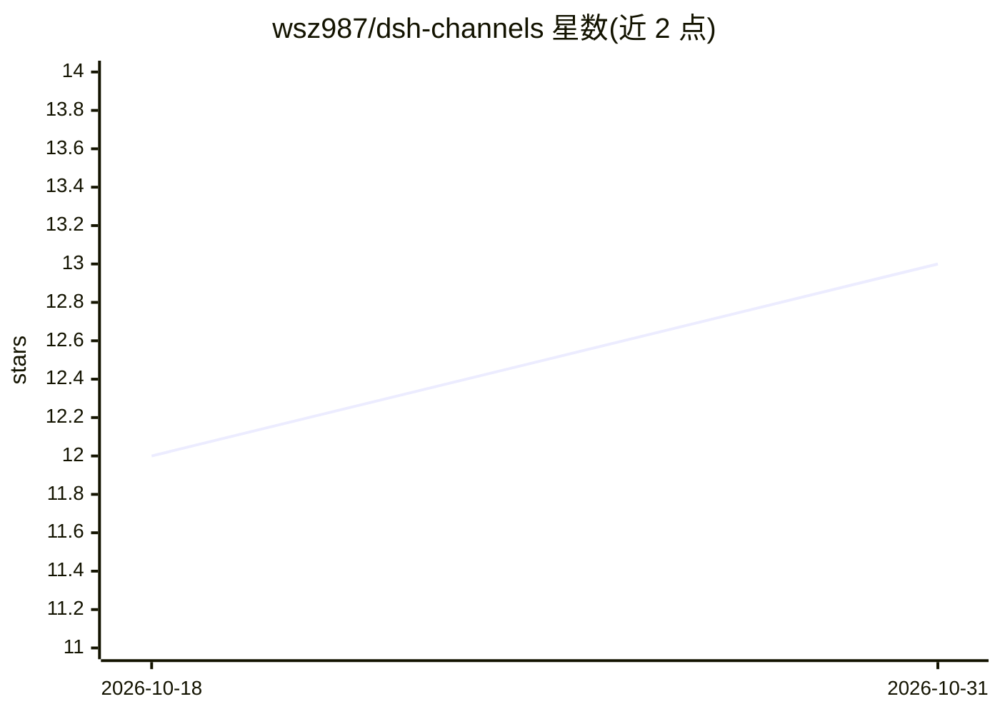

# wsz987/dsh-channels

⭐ 13 · TypeScript · MIT · 推送 2026-09-11 · [GitHub](https://github.com/wsz987/dsh-channels) · 个人维护 · 中文 README

**将微信/QQ/钉钉/飞书/Telegram 接入 DeepSeek Harness 的插件**

社区维护的 DeepSeek Harness 渠道扩展插件：把微信、QQ、钉钉、飞书、Telegram 五个 IM 平台接入 Harness Agent，在 Harness Web 面板统一配置、扫码授权后，用户可在各 IM 对话框直接与 Agent 对话。支持文本、图片、文件收发，Agent 可读取 PDF/DOCX/XLSX 和文本附件（入站单文件上限 100 MiB）。通过 npx 以插件形式安装，要求 Harness 0.1.5-rc.2 与 Node 22.19+；采用适配器层架构，支持新增渠道二次开发。

## 筛选速览

| 维度 | 判定 | 备注 |
|---|---|---|
| AI 角色 | `ai-ecosystem` | LLM/agent 周边工具 |
| 许可风险 | `permissive` | MIT |
| 部署形态 | `library` | 以包/库形式分发 |
| 模型依赖 | locked-api |  |
| 硬件要求 | — | 无带数字的原话,不猜 |
| 安装摩擦 | `low` | 无编译、无系统依赖或容器化 |
| 成熟度 | `idea` | |

## 能力要点

- 五个内置渠道适配器（微信/QQ/钉钉/飞书/Telegram），统一配置与扫码授权
- 图片与文件收发，Agent 可读取 PDF/DOCX/XLSX 及文本附件（上限 100 MiB）
- 渠道内斜杠指令（/stop、/model、/mirror 等）由 Harness 官方命令系统解析
- 适配器层零侵入核心的分层架构，提供新渠道脚手架与契约验证

## 适用场景

- 在微信或 Telegram 里直接和 DeepSeek Harness Agent 对话
- 通过 IM 发送 PDF/DOCX/XLSX 文件让 Agent 读取处理
- 为团队配置多 IM 渠道统一接入本机 Agent 并控制访问权限

## 场景标签

`聊天机器人` · 领域:对话与助手

## 证据(README 行号)

> L3: 将微信、QQ、钉钉、飞书和 Telegram 接入 DeepSeek Harness
> L18: > 本项目是社区维护的 DeepSeek Harness 渠道扩展，不是 DeepSeek Harness 或各消息平台的官方项目。项目参考各平台面向 OpenClaw 提供的渠道接入方案，结合官方 SDK / API 适配到 D
> L22: 接入后，在 Harness Web“设置 → 渠道”面板统一配置与扫码授权，并在各平台对话框中直接与 Agent 对话（图片来源：docs/ScreenShot）：

## 星数曲线

2026-10-18 12 → 2026-10-31 13（+1）

---
*卡片 v1 · prompt 1.4 · 生成 2026-10-31 · 置信度 high · 依据 README sha `dfe5115bc43b` · [字段定义](../../DATASET.md)*
