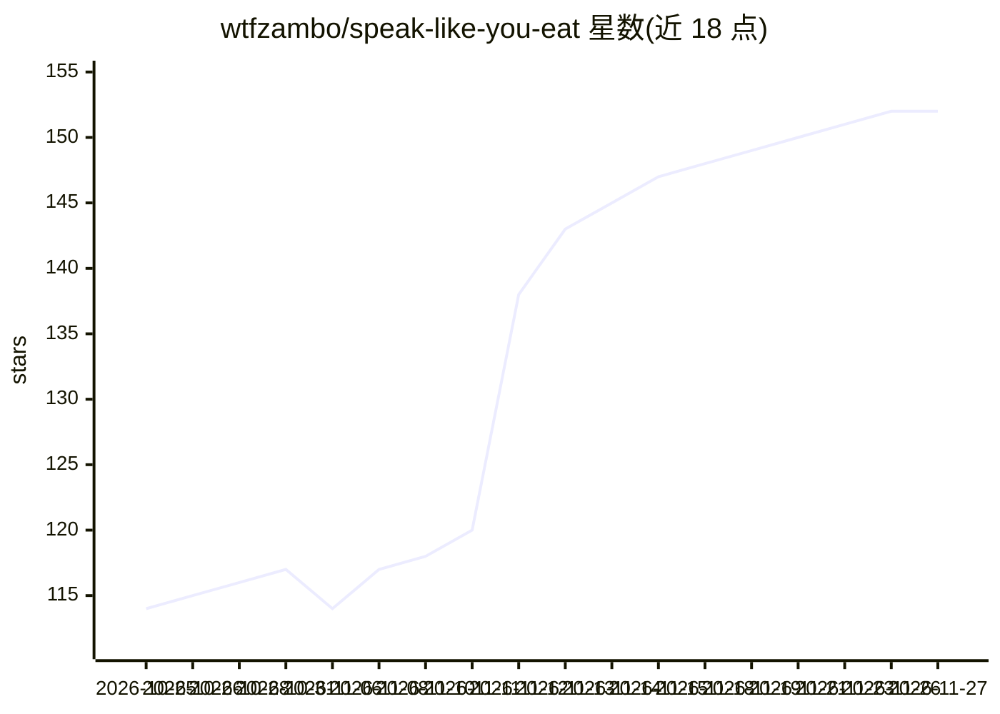

# wtfzambo/speak-like-you-eat

⭐ 152 · TypeScript · MIT · 推送 2026-11-09 · [GitHub](https://github.com/wtfzambo/speak-like-you-eat) · [官网](https://www.npmjs.com/package/speak-like-you-eat) · 个人维护

**为 Pi/OMP 用户把 AI 回答改写成平实语言的插件**

SLYE 是 Pi 与 Oh My Pi (OMP) 的扩展包：AI 回答完成后运行 /slye，会把最新完成的助手回复改写为平实语言版本，以卡片形式附在原文下方且不修改原文。Pi 端每张卡片含 ELI5 与 Light 两个版本可切换，支持 /slye on 自动改写、模型选择与自定义系统提示词。改写通过宿主的模型注册表发送独立请求（Pi 端并行两次请求），每次改写需额外付费与延迟；自动改写要求回复至少 200 个非空白正文字符且正常完成。

## 筛选速览

| 维度 | 判定 | 备注 |
|---|---|---|
| AI 角色 | `ai-native` | 本体是模型或模型工具 |
| 许可风险 | `permissive` | MIT |
| 部署形态 | `None` |  |
| 模型依赖 | — | README 未给出锁定关系 |
| 硬件要求 | — | 无带数字的原话,不猜 |
| 安装摩擦 | `low` | 无编译、无系统依赖或容器化 |
| 成熟度 | — | 结构信号不足 |

## 能力要点

- 在原文下方附加不改写原响应的平实语言卡片，不进入 LLM 上下文
- Pi 端 ELI5 与 Light 两种改写版本可切换（ctrl+\）
- 支持自动改写开关、模型选择与自定义 slye-prompt.md 提示词
- 只发送隔离 payload，不加载项目文件/技能/完整会话历史

## 适用场景

- 把 AI 助手的术语密集回答改写成易懂版本
- 为偏好快速结论的读者生成 ELI5 式摘要卡片
- 在 Pi/OMP 中配置低成本模型自动改写每条回答

## 场景标签

`AI 写作` · 领域:内容生成

## 证据(README 行号)

> L7: SLYE is a Pi and Oh My Pi (OMP) package that adds a plain-language rewrite after a completed response.
> L35: 1. After Pi or OMP finishes an answer, run `/slye` for an eligible target. It rewrites the latest completed assista

## 星数曲线

2026-10-25 114 → 2026-11-27 152（+38）

---
*卡片 v1 · prompt 1.4 · 生成 2026-11-27 · 置信度 high · 依据 README sha `cf7aea793e54` · [字段定义](../../DATASET.md)*
