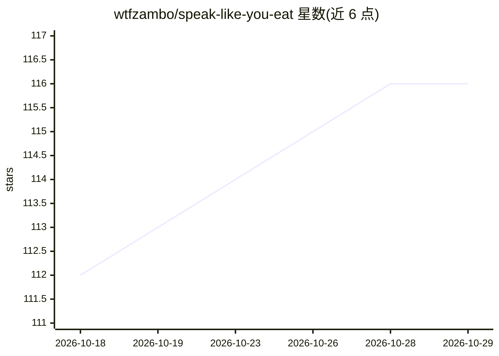

# wtfzambo/speak-like-you-eat

⭐ 116 · TypeScript · MIT · 推送 2026-10-22 · [GitHub](https://github.com/wtfzambo/speak-like-you-eat) · [官网](https://www.npmjs.com/package/speak-like-you-eat) · 个人维护

**Pi/OMP 插件：把 AI 回答改写成平实语言（≤30字：给 Pi/OMP 用户把 AI 回答重写为平实语言）**

面向 Pi 与 Oh My Pi（OMP）终端使用者的扩展包：在一条回答完成后，通过 /slye 命令或自动模式调用所选模型，在原回答下方追加一张平实语言改写卡片，原文保持不变且卡片不进入 LLM 上下文。Pi 上每张卡片含 ELI5 与 Light 两个版本（两次并行请求，成本约为单版本两倍），OMP 仅显示 Light 版。支持自定义 Light 系统提示、模型与范围选择；自动改写要求回答含至少 200 个非空白正文字符。README 基于小规模人工试用给出模型排序观察（非保证）。

## 筛选速览

| 维度 | 判定 | 备注 |
|---|---|---|
| AI 角色 | `ai-native` | 本体是模型或模型工具 |
| 许可风险 | `permissive` | MIT |
| 部署形态 | `None` |  |
| 模型依赖 | — | README 未给出锁定关系 |
| 硬件要求 | — | 无带数字的原话,不猜 |
| 安装摩擦 | `low` | 无编译、无系统依赖或容器化 |
| 成熟度 | — | 结构信号不足 |

## 能力要点

- 按需 /slye 或自动模式改写最近完成的助手回答，原文保持不变
- Pi 提供 ELI5 与 Light 双版本卡片（ctrl+\ 切换），OMP 仅 Light
- 可用 slye-prompt.md 自定义 Light 系统提示
- 改写发送隔离负载，不加载项目文件、技能或完整会话历史

## 适用场景

- 把冗长或充满行话的 AI 回答转成易读的平实语言
- 在 Pi/OMP 中自动为符合条件（≥200 字符正文）的回答追加通俗版
- 用自选便宜快速模型生成保留结论、行动与代码示例的摘要版回答

## 场景标签

`AI 写作` · 领域:内容生成

## 证据(README 行号)

> L7: SLYE is a Pi and Oh My Pi (OMP) package that adds a plain-language rewrite after a completed response.
> L35: 1. After Pi or OMP finishes an answer, run `/slye` for an eligible target. It rewrites the latest completed assista
> L50: - **ELI5** (active by default): rebuilds the answer for a reader who wants the point fast. It starts with the concl

## 星数曲线

2026-10-18 112 → 2026-10-29 116（+4）

---
*卡片 v1 · prompt 1.4 · 生成 2026-10-23 · 置信度 high · 依据 README sha `94fce2a53c65` · [字段定义](../../DATASET.md)*
