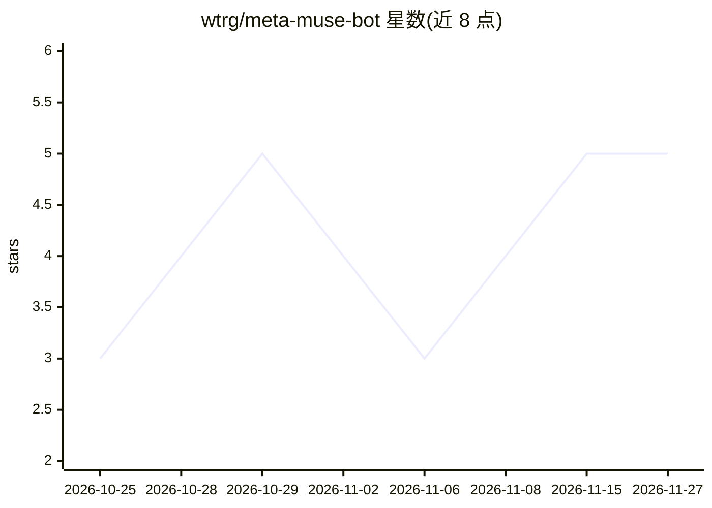

# wtrg/meta-muse-bot

⭐ 5 · TypeScript · MIT · 推送 2026-10-22 · [GitHub](https://github.com/wtrg/meta-muse-bot) · 个人维护

**muse.ai 自动注册机器人与 Cloudflare 自托管临时邮箱平台**

仓库包含两部分：其一是 Meta Muse（muse.ai）注册自动化机器人，用 Playwright 自动生成临时邮箱、捕获 OTP、填写资料、通过邀请码绕过等待名单，并集成 Psiphon 美国出口与 Cloudflare Tunnel 对外提供 OTP 获取链接，输出 CSV/Excel 报告；其二是 SpinupMail，基于 Cloudflare Email Routing 与 Workers 的自托管临时邮箱平台，支持组织管理、附件存储（R2/D1）、API Key 自动化与 Telegram 通知，含浏览器扩展与 TypeScript SDK。

## 筛选速览

| 维度 | 判定 | 备注 |
|---|---|---|
| AI 角色 | `ai-ecosystem` | LLM/agent 周边工具 |
| 许可风险 | `permissive` | MIT |
| 部署形态 | `library` | 以包/库形式分发 |
| 模型依赖 | — | README 未给出锁定关系 |
| 硬件要求 | — | 无带数字的原话,不猜 |
| 安装摩擦 | `low` | 无编译、无系统依赖或容器化 |
| 成熟度 | — | 结构信号不足 |

## 能力要点

- 临时邮箱引擎生成国际域名邮箱并自动捕获 6 位 OTP（2-4 秒）
- 邀请码机制绕过等待名单进入聊天界面
- Cloudflare Tunnel 提供公开 OTP 获取链接，输出四列 CSV/Excel 报告
- SpinupMail 支持组织级无限邮箱、附件存储与 API Key 自动化

## 适用场景

- 批量自动化注册 muse.ai 账号并管理凭据
- 在自有域名上自托管团队临时邮箱
- 为测试套件生成自动化邮箱 API

## 场景标签

`浏览器自动化` · 领域:效率与自动化

## 证据(README 行号)

> L24: Tích hợp bộ công cụ tự động hóa toàn diện đăng ký và mở khóa giao diện Chat cho **Meta Muse (muse.ai)**:
> L41: SpinupMail is an open-source temporary email platform for teams, built on

## 星数曲线

2026-10-25 3 → 2026-11-27 5（+2）

---
*卡片 v1 · prompt 1.4 · 生成 2026-11-21 · 置信度 mid · 依据 README sha `1d006eaf2ad7` · [字段定义](../../DATASET.md)*
