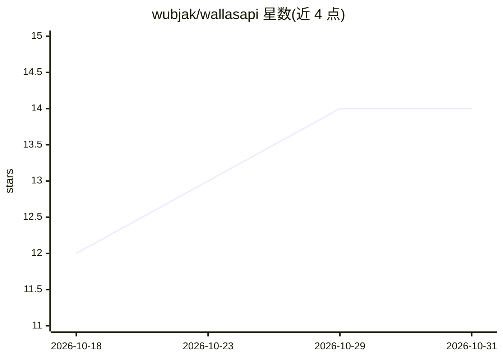

# wubjak/wallasapi

⭐ 14 · Python · NOASSERTION · 推送 2026-08-23 · [GitHub](https://github.com/wubjak/wallasapi) · [官网](https://ko-fi.com/wubjak) · 个人维护

**自托管的 OpenAI 兼容多提供商 AI 路由网关**

基于 FastAPI 的本地 API 服务：将 12+ 家 AI 提供商（Gemini、Groq、OpenRouter、Ollama 等）聚合到单一 OpenAI 兼容端点，按内容模态、速度、成本与可用性自动选路并在失败时透明回退。提供虚拟模型（auto/rapido/razonamiento 等策略名）、统一图像/视频/语音生成端点、OCR 回退链、本地 JSON 会话存储与 Obsidian 同步。面向不想绑定单一厂商、复用现有 OpenAI SDK 代码的开发者；通过 git clone + venv + requirements.txt 安装，Windows 用 start.bat，Debian/Ubuntu 需装 libgl1 等系统包。

## 筛选速览

| 维度 | 判定 | 备注 |
|---|---|---|
| AI 角色 | `ai-ecosystem` | LLM/agent 周边工具 |
| 许可风险 | `none` | NOASSERTION |
| 部署形态 | `library` | 以包/库形式分发 |
| 模型依赖 | local-ok | 支持本地模型 |
| 硬件要求 | — | 无带数字的原话,不猜 |
| 安装摩擦 | `low` | 无编译、无系统依赖或容器化 |
| 成熟度 | — | 结构信号不足 |

## 能力要点

- 12+ 提供商聚合为单一 OpenAI 兼容端点，自动选路与透明回退
- 能力感知路由：按模态/推理/工具调用等信号分类模型，响应暴露路由解释头
- 统一 embeddings、图像/视频生成、TTS 与 OCR 回退链（EasyOCR→Mistral→Gemini→Ollama）
- 模型发现过滤（pricing=free&capability=vision）与路由决策解释端点

## 适用场景

- 让现有 OpenAI SDK 代码不改一行接入多家提供商
- 单一提供商故障时自动回退保持应用可用
- 用免费层级访问 600+ 模型并按能力过滤选型
- 通过 Ollama 在本地离线运行模型

## 场景标签

 · 领域:LLM 基础设施/API 网关

## 证据(README 行号)

> L5: **The unified, OpenAI-compatible router that automatically picks the best AI provider for every request — and falls 
> L42: **WallasAPI solves all of this with one OpenAI-compatible endpoint.** Send a request, and it:
> L50: **Your existing OpenAI SDK code works unchanged.** Just point it at `http://localhost:8001/v1`.

## 星数曲线

2026-10-18 12 → 2026-10-31 14（+2）

---
*卡片 v1 · prompt 1.4 · 生成 2026-10-31 · 置信度 mid · 依据 README sha `c4ce7a87fbc3` · [字段定义](../../DATASET.md)*
