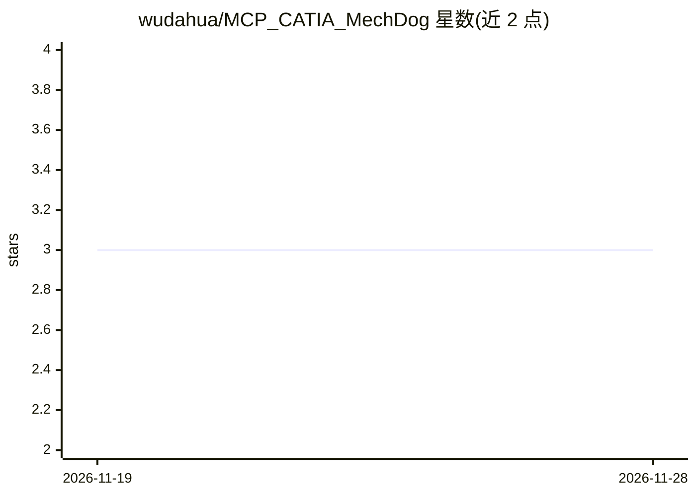

# wudahua/MCP_CATIA_MechDog

⭐ 3 · Python · MIT · 推送 2026-11-23 · [GitHub](https://github.com/wudahua/MCP_CATIA_MechDog) · 个人维护 · 中文 README

**让 AI 客户端通过 MCP 在 CATIA V5 中生成可编辑的 3D 模型**

本地 MCP 服务，运行于 Windows，把 CATIA V5 的 COM Automation 封装成 155 个工具（14 组），供 Claude Desktop、Cursor 等支持 MCP 的客户端调用。功能覆盖草图、零件设计、曲面、装配、工程图、测量与导出（STEP/STL/IGES）。每次特征操作回执报告体积变化，测量失败时标记 UNVERIFIED 而非报成功。面向重复性参数化建模、按规格批量出零件等场景；不适合自由曲面造型与无 CATIA 许可的环境。本仓库是上游 catia-v5-mcp-server 的 lite fork。

## 筛选速览

| 维度 | 判定 | 备注 |
|---|---|---|
| AI 角色 | `ai-ecosystem` | LLM/agent 周边工具 |
| 许可风险 | `permissive` | MIT |
| 部署形态 | `desktop` | 安装包/桌面程序 |
| 模型依赖 | — | README 未给出锁定关系 |
| 硬件要求 | — | 无带数字的原话,不猜 |
| 安装摩擦 | `low` | 无编译、无系统依赖或容器化 |
| 成熟度 | — | 结构信号不足 |

## 能力要点

- 封装 CATIA V5 COM Automation 为 155 个工具，14 个功能组
- 每次切除/凸台等操作回执报告前后体积，测量失败输出 UNVERIFIED
- 2473 个离线测试无需安装 CATIA 即可运行
- 支持 stdio 与 Streamable HTTP 两种传输方式

## 适用场景

- 重复性参数化建模
- 按图纸/规格批量生成零件
- AI 驱动的草图→实体→装配流程
- 接管已有 CATIA 模型继续修改

## 场景标签

`代码生成` · 领域:编码与开发

## 证据(README 行号)

> L9: MCP_CATIA_MechDog 是运行在你自己 Windows 电脑上的本地 MCP 服务（stdio，可选 HTTP）。它把 CATIA V5 的 **COM Automation** 封装成 **155 个工具**（14 组
> L13: **适合**：重复性参数化建模、按图纸/规格批量出零件、AI 驱动的草图→实体→装配流程、接管已有模型继续改。

## 星数曲线

2026-11-19 3 → 2026-11-28 3（+0）

---
*卡片 v1 · prompt 1.4 · 生成 2026-11-21 · 置信度 high · 依据 README sha `6a50ddde63fe` · [字段定义](../../DATASET.md)*
