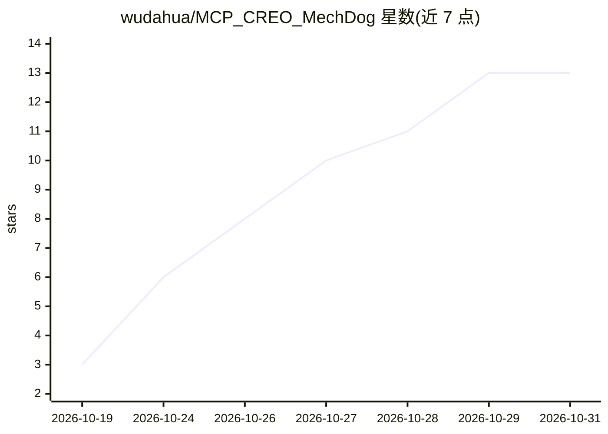

# wudahua/MCP_CREO_MechDog

⭐ 13 · Python · MIT · 推送 2026-10-30 · [GitHub](https://github.com/wudahua/MCP_CREO_MechDog) · 个人维护 · 中文 README

**让 AI 客户端通过 MCP 直接驱动 Creo 建原生参数化特征的本地服务**

运行在 Windows 上的本地 MCP stdio 服务，按需启动或连接 Creo Parametric 9/10/12，通过官方 C/C++ Toolkit 创建、查询和修改原生参数化特征。当前注册 94 个工具，覆盖草图、拉伸、旋转、孔、钣金、装配、工程图、放样、翼型等；特征保存为 Creo 可编辑特征树，每步保存重载验证。使用者需自行准备 Creo 许可与 Toolkit SDK，运行 setup.ps1 编译执行器，再由本地 AI 客户端调用。部分环境与参数组合尚未实机验收。

## 筛选速览

| 维度 | 判定 | 备注 |
|---|---|---|
| AI 角色 | `ai-ecosystem` | LLM/agent 周边工具 |
| 许可风险 | `permissive` | MIT |
| 部署形态 | `desktop` | 安装包/桌面程序 |
| 模型依赖 | — | README 未给出锁定关系 |
| 硬件要求 | — | 无带数字的原话,不猜 |
| 安装摩擦 | `low` | 无编译、无系统依赖或容器化 |
| 成熟度 | `idea` | |

## 能力要点

- 94 个 MCP 工具，覆盖零件、钣金、装配、工程图、UDF、放样/翼型等原生特征
- 官方 C/C++ Toolkit 驱动，特征保留尺寸与依赖，可编辑原生特征树
- 每步保存重载回读验证，带 revision 与作业轮询机制
- 支持 STEP/IGES/STL/JPEG 导出与原生 DRW/PDF 工程图输出

## 适用场景

- 让本地 AI 客户端按自然语言规划逐步生成 Creo 原生零件
- 用 MCP 工具批量修改参数化模型的尺寸、参数与关系式
- 查询与导出磁盘既有 .prt/.asm 模型（STEP/STL 等）

## 场景标签

 · 领域:CAD/机械工程 AI 工具链

## 证据(README 行号)

> L5: 本地 Windows MCP 服务，按需启动或连接 Creo Parametric 9 / 10 / 12，通过官方 C/C++ Toolkit 创建、查询和修改**原生参数化特征**。当前开发与发布按本机 Creo 12.4.0.
> L7: 当前注册 **94 个工具**，实际可见清单以 `creo_capabilities` 为准。接口覆盖常见实体特征、磁盘模型打开、受管副本接管、会话枚举、**装配只读检查与回放规划**、受控恢复、**显式世代回收**及直接混合，**

## 星数曲线

2026-10-19 3 → 2026-10-31 13（+10）

---
*卡片 v1 · prompt 1.4 · 生成 2026-10-31 · 置信度 mid · 依据 README sha `da3ffc532b9d` · [字段定义](../../DATASET.md)*
