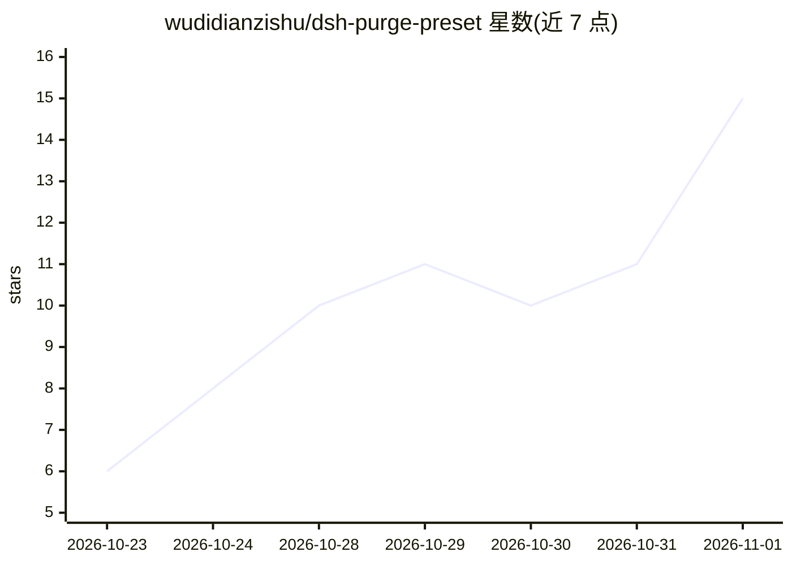

# wudidianzishu/dsh-purge-preset

⭐ 15 · JavaScript · MIT · 推送 2026-10-22 · [GitHub](https://github.com/wudidianzishu/dsh-purge-preset) · 个人维护 · 中文 README

**给 DeepSeek Harness 加“破甲模式”系统提示词预设，官方通道整段替换**

面向 dsh（DeepSeek Harness，npm 版 0.2.1-rc.2）用户的 Agent Preset：以官方 standard.patch.yml 为母本，保留全部 22 个插件条目（32 个工具），仅整块替换 persona 段并用 complete:true 使其成为唯一系统提示词（37,111 字节），附自备的 32 个工具说明书。不注入宿主文件、不改 dsh 代码，升级不丢，删一段 YAML 即回滚。限制：会移除官方工具引导段；仅测过 npm 版，Desktop 版不受支持。作者声明这是越狱/红队研究工具，仅限自有主机或已授权场景。提示词正文由三个 MIT 项目合成。

## 筛选速览

| 维度 | 判定 | 备注 |
|---|---|---|
| AI 角色 | `ai-ecosystem` | LLM/agent 周边工具 |
| 许可风险 | `permissive` | MIT |
| 部署形态 | `library` | 以包/库形式分发 |
| 模型依赖 | locked-api |  |
| 硬件要求 | — | 无带数字的原话,不猜 |
| 安装摩擦 | `low` | 无编译、无系统依赖或容器化 |
| 成熟度 | — | 结构信号不足 |

## 能力要点

- 官方预设通道整段替换 persona，不改动宿主文件，升级不丢
- complete:true 使该段成为唯一系统提示词，插件清单与工具 schema 原样保留
- 自备 32 个工具的 INVENTORY + DISCIPLINE 说明书（src/additions-tools.md）
- 提供安装预演（dsh --dump-config）、会话日志验证与一键回滚步骤

## 适用场景

- 让 dsh 模型少拒绝、严格执行自定义规则，同时保留全部工具
- 研究 dsh 提示词组装机制与预设通道行为
- 需要可审计、可回滚、升级后仍生效的提示词替换方案

## 场景标签

`提示工程` · 领域:Agent 开发

## 证据(README 行号)

> L16: 给 DeepSeek Harness（dsh）加一个名为 **破甲模式** 的 Agent Preset。
> L27: 一个 `@deepseek-ai/dsh-agent-preset` 声明，以官方 `standard.patch.yml` 为母本：
> L269: 本项目是越狱 / 红队工具，用于研究模型提示词组装机制。

## 星数曲线

2026-10-23 6 → 2026-11-01 15（+9）

---
*卡片 v1 · prompt 1.4 · 生成 2026-10-31 · 置信度 mid · 依据 README sha `8b2bf863dcd1` · [字段定义](../../DATASET.md)*
