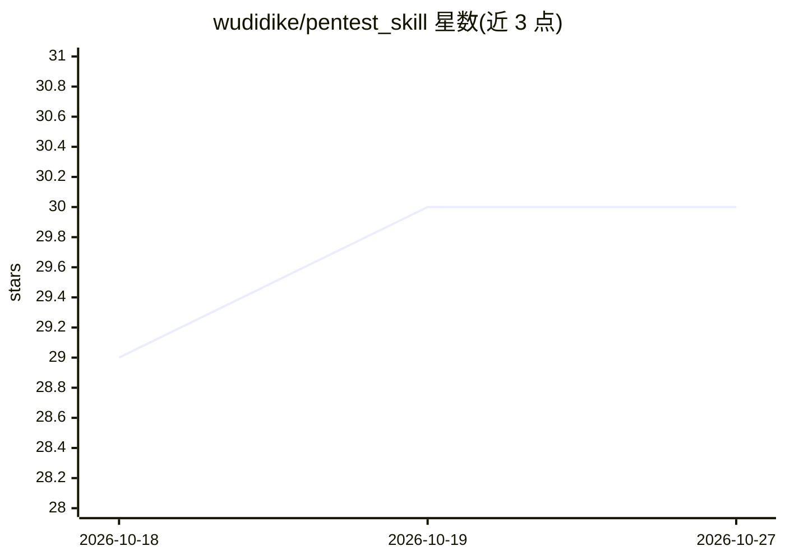

# wudidike/pentest_skill

⭐ 30 · Python · NOASSERTION · 推送 2026-08-12 · [GitHub](https://github.com/wudidike/pentest_skill) · 个人维护 · 中文 README

**面向 AI Agent 的黑盒 Web 渗透测试工作流 skill**

以 SKILL.md 为工作流控制器的黑盒 Web 渗透/SRC/Bug bounty 自动化技能包：5 阶段流程（合规门→被动侦察→主动探测→漏洞探测→报告），每阶段设 checkpoint，未通过不进入下一阶段；配 48 个 Python 脚本（侦察/扫描/验证/报告）按需调用，payload 与 playbook 按需读取不预加载。通过 git clone 安装，配套 setup.sh 与健康检查脚本；在 Claude Code 中通过对话触发使用；仅供授权安全测试。

## 筛选速览

| 维度 | 判定 | 备注 |
|---|---|---|
| AI 角色 | `ai-ecosystem` | LLM/agent 周边工具 |
| 许可风险 | `permissive` | NOASSERTION |
| 部署形态 | `None` |  |
| 模型依赖 | — | README 未给出锁定关系 |
| 硬件要求 | — | 无带数字的原话,不猜 |
| 安装摩擦 | `low` | 无编译、无系统依赖或容器化 |
| 成熟度 | — | 结构信号不足 |

## 能力要点

- 5 阶段 checkpoint 驱动工作流（Intake/Recon/Enum/Hunt/Report）
- 48 个 Python 脚本覆盖侦察/扫描/验证/报告
- SKILL.md 工作流控制器（197 行）
- payload/playbook 按需 Read 不预加载

## 适用场景

- 授权场景下让 Claude Code 等 agent 执行黑盒 Web 渗透测试流程
- SRC 与 Bug bounty 工作中按阶段推进并留 checkpoint
- 对目标站点做侦察、探测与漏洞验证后生成报告

## 场景标签

 · 领域:网络安全/渗透测试

## 证据(README 行号)

> L6: 实战黑盒 Web 渗透测试 / SRC / Bug bounty 工作流 skill。checkpoint 驱动，人判断方向，脚本按需调用。
> L21: ├── SKILL.md                    工作流控制器 (197行, 5阶段checkpoint)
> L37: # Claude Code: 直接对话触发

## 星数曲线

2026-10-18 29 → 2026-10-27 30（+1）

---
*卡片 v1 · prompt 1.4 · 生成 2026-10-26 · 置信度 high · 依据 README sha `69c762bf572d` · [字段定义](../../DATASET.md)*
