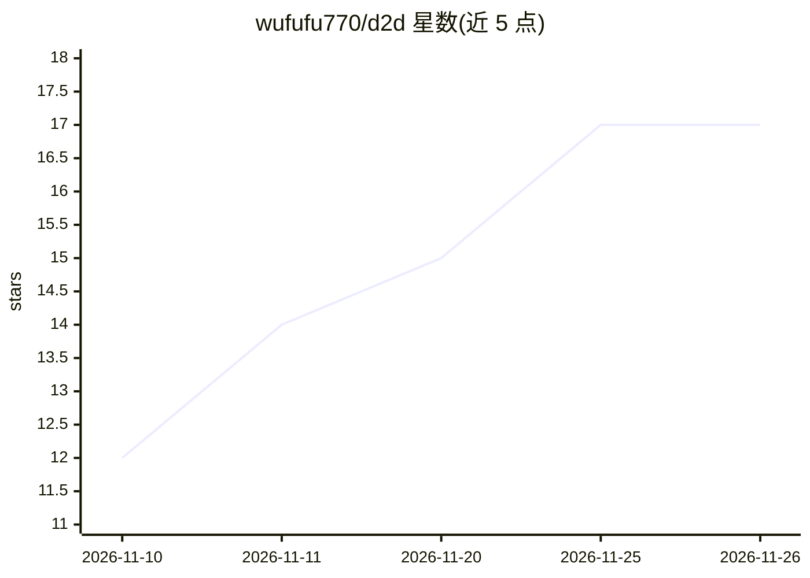

# wufufu770/d2d

⭐ 17 · JavaScript · Apache-2.0 · 推送 2026-11-18 · [GitHub](https://github.com/wufufu770/d2d) · 个人维护 · 中文 README

**授权渗透测试的三环并行多 agent 框架（dsh 插件）**

以 dsh 插件形态运行的渗透测试框架：发现环/深度攻击环/创造探索环三类 agent 并行竞速，经 Kuzu/ladybug 图数据库作共享黑板，配三环调度、容量账本与唤醒预算。内置双模型净室复核双签验证链、X-Ring 受控自主通道（预算熔断+机械重放+人工裁决）、出口网关代理、scope 门控与 append-only 审计链等安全模型；另提供 dsh web 面板、MCP 只读 server 与 260 张知识卡片库。限授权安全测试场景，通过 install.sh 与 systemd user 单元部署。

## 筛选速览

| 维度 | 判定 | 备注 |
|---|---|---|
| AI 角色 | `ai-ecosystem` | LLM/agent 周边工具 |
| 许可风险 | `permissive` | Apache-2.0 |
| 部署形态 | `library` | 以包/库形式分发 |
| 模型依赖 | — | README 未给出锁定关系 |
| 硬件要求 | — | 无带数字的原话,不猜 |
| 安装摩擦 | `low` | 无编译、无系统依赖或容器化 |
| 成熟度 | — | 结构信号不足 |

## 能力要点

- 三类 agent 并行竞速 + Kuzu/ladybug 图数据库共享黑板
- 双签验证链：critical/high 双模型净室复核与 disputed 人工仲裁
- 多层安全门：出口治理、scope 门控、写面分级、审计链
- X-Ring 受控自主：时长+token 双路径熔断、verifyRunner 机械重放

## 适用场景

- 授权渗透测试/SRC/靶场中并行调度多类攻击 agent
- 安全团队需要带审计链与人工裁决的自动化测试流水线
- 通过图数据库追踪资产与漏洞发现的关联关系

## 场景标签

`Agent 框架` `多智能体` `网络安全` · 领域:Agent 开发

## 证据(README 行号)

> L3: **三环并行自主渗透测试框架** —— 发现环 / 深度攻击环 / 创造探索环三类 agent 并行竞速，共享图数据库黑板，自带星图认知层、知识脑与观测面板。以 dsh 插件形态运行。
> L46: |loop|`plugin/pentest-dsh/scheduler/`|三环调度/预算/容量账本|
> L65: - 图引擎：生产 ladybug（`LBUG_C_API_LIB_PATH` 注入），测试双轨（kuzu 轨+ladybug 轨全量等值）。

## 星数曲线

2026-11-10 12 → 2026-11-26 17（+5）

---
*卡片 v1 · prompt 1.4 · 生成 2026-11-18 · 置信度 low · 依据 README sha `17bba9c98647` · [字段定义](../../DATASET.md)*
