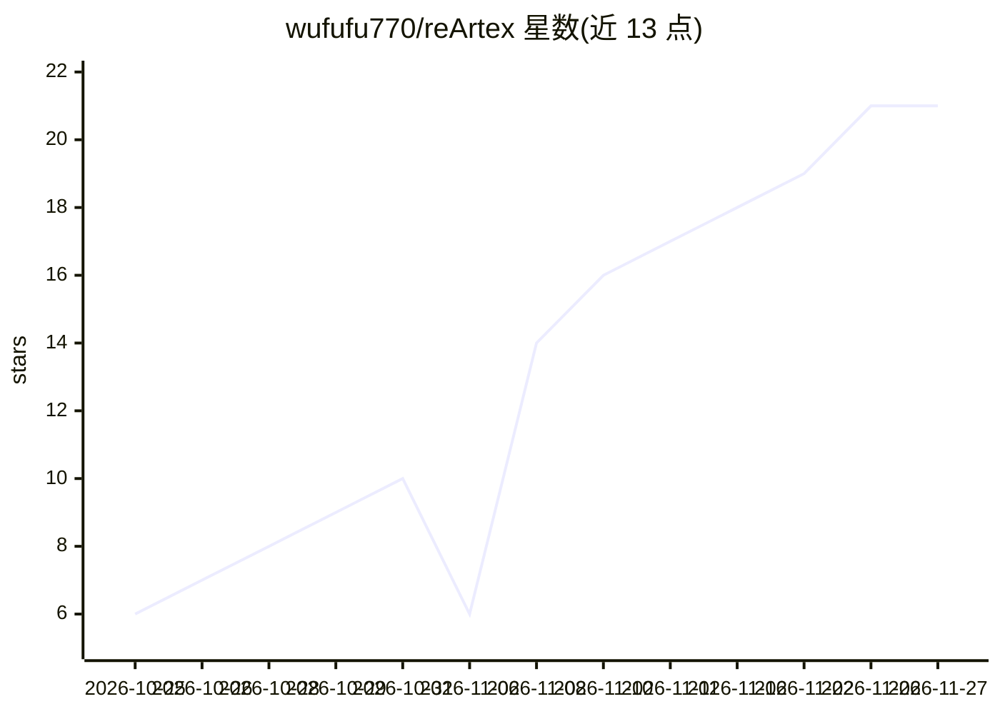

# wufufu770/reArtex

⭐ 21 · Go · AGPL-3.0 · 推送 2026-11-24 · [GitHub](https://github.com/wufufu770/reArtex) · 个人维护 · 中文 README

**LLM 多 agent 驱动的自主渗透测试系统（Artex 二开）**

对 Artex 的二次开发：Go 单体后端内嵌 Next.js 前端 + PostgreSQL，agent 能力由 norma SDK 提供。planner 依据探索图态势派发意图，worker 用真实工具执行并写回资产与漏洞；维护探索图与资产图双图结构，支持对话干预、审批门、steer 纠偏、流量录制、独立漏洞复测 agent，可从 ScopeSentry 导入资产。提供 Docker Compose、预编译二进制、一键脚本与源码编译四种安装方式。声明仅限本地隔离环境的学习研究，禁止一切实际攻击用途。

## 筛选速览

| 维度 | 判定 | 备注 |
|---|---|---|
| AI 角色 | `ai-native` | 本体是模型或模型工具 |
| 许可风险 | `viral` | AGPL-3.0 |
| 部署形态 | `self-host` | docker 或自建部署 |
| 模型依赖 | — | README 未给出锁定关系 |
| 硬件要求 | — | 无带数字的原话,不猜 |
| 安装摩擦 | `low` | 无编译、无系统依赖或容器化 |
| 成熟度 | — | 结构信号不足 |

## 能力要点

- planner/worker 分工：意图派发、真实工具执行、写回后即停
- 探索图 + 资产图双图结构，经锚点互查
- 人在环路：对话干预、审批门、steer 纠偏、流量录制与证据留存
- 独立复测 Agent，结论分「仍可复现/已修复/无法确认」

## 适用场景

- 在本地隔离环境验证多 agent 渗透测试的技术原理
- 学习 planner/worker 与双图架构的实现
- 研究 LLM agent 在安全自动化中的任务拆解与执行

## 场景标签

`多智能体` `网络安全` · 领域:Agent 开发

## 证据(README 行号)

> L11: reArtex 是一套 LLM 多 agent 驱动的自主渗透测试系统：Go 单体后端（内嵌 Next.js 前端）+ PostgreSQL，agent 能力由 norma SDK 提供。
> L15: - **目标拆解**：planner 读探索图态势、判目标、派意图；worker 领一条意图用真实工具执行，把新资产、事实与漏洞写回后即停。

## 星数曲线

2026-10-25 6 → 2026-11-27 21（+15）

---
*卡片 v1 · prompt 1.4 · 生成 2026-11-18 · 置信度 high · 依据 README sha `231cd7d45145` · [字段定义](../../DATASET.md)*
