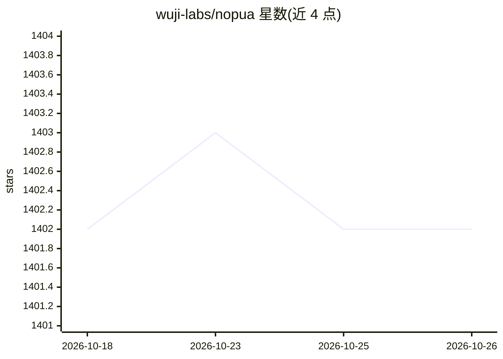

# wuji-labs/nopua

⭐ 1,402 · Python · MIT · 推送 2026-09-28 · [GitHub](https://github.com/wuji-labs/nopua) · 组织维护 · 中文 README

**面向 AI 编程 agent 的反 PUA（信任驱动）Skill**

一个加载到 Claude Code、Codex CLI、Cursor、Kiro 等 AI 编程 agent 中的 SKILL：保留穷尽尝试、自验证、主动检查等方法论，将威胁式激励替换为信任式激励，按失败次数给出切换视角、上升层级、归零重来、诚实交接等递进策略。README 引用心理学与 LLM 行为研究论证恐惧式提示的负面效应，并在 9 个真实调试场景中给出隐藏问题发现 +104% 等自报基准数据。MIT 许可，提供 6 种语言文档。

## 筛选速览

| 维度 | 判定 | 备注 |
|---|---|---|
| AI 角色 | `ai-ecosystem` | LLM/agent 周边工具 |
| 许可风险 | `permissive` | MIT |
| 部署形态 | `None` |  |
| 模型依赖 | — | README 未给出锁定关系 |
| 硬件要求 | — | 无带数字的原话,不猜 |
| 安装摩擦 | `low` | 无编译、无系统依赖或容器化 |
| 成熟度 | — | 结构信号不足 |

## 能力要点

- 失败 2-5 次的递进策略（Switch Eyes/Elevate/Reset to Zero/Surrender）
- 保留 PUA 类 skill 的方法论要素，仅替换激励方式
- 附 9 场景自报基准：隐藏问题发现 +104%
- 引用心理学与 LLM 研究文献论证设计

## 适用场景

- 让编程 agent 在调试中不隐瞒不确定性与未验证结果
- 希望 agent 修复显式问题后继续排查相关隐藏问题
- 替换威胁式提示词为信任式提示的替代选项

## 场景标签

`提示工程` · 领域:Agent 开发

## 证据(README 行号)

> L19:  Claude Code
> L21:  Cursor
> L130: NoPUA preserves every methodological element that makes PUA effective:

## 星数曲线

2026-10-18 1,402 → 2026-10-26 1,402（+0）

---
*卡片 v1 · prompt 1.4 · 生成 2026-10-21 · 置信度 high · 依据 README sha `628174a8ae87` · [字段定义](../../DATASET.md)*
