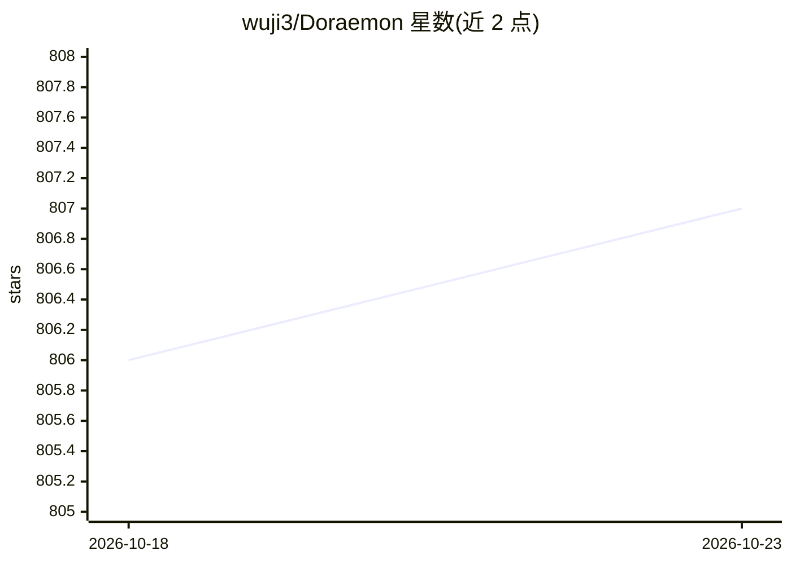

# wuji3/Doraemon

⭐ 807 · Python · GPL-3.0 · 推送 2026-05-05 · [GitHub](https://github.com/wuji3/Doraemon) · 组织维护

**PyTorch 视觉建模库：图像分类、检索与人脸识别的训练部署**

基于 PyTorch 的视觉建模库，覆盖图像分类、基于内容的图像检索与人脸识别任务。集成 timm 的 1000+ 视觉骨干网络，提供统一训练流程、度量学习损失（ArcFace、CircleLoss、MagFace 等）、数据增强、GradCAM 可视化与坏例分析。部署侧支持本地推理 *.pt 模型及 Hugging Face AutoModel/AutoProcessor 兼容发布。人脸识别端到端公开流程标注为整理中（In progress），支持 MS-Celeb-1M-v1c 训练与 LFW 评测。

## 筛选速览

| 维度 | 判定 | 备注 |
|---|---|---|
| AI 角色 | `ai-native` | 本体是模型或模型工具 |
| 许可风险 | `viral` | GPL-3.0 |
| 部署形态 | `None` |  |
| 模型依赖 | — | README 未给出锁定关系 |
| 硬件要求 | — | 无带数字的原话,不猜 |
| 安装摩擦 | `low` | 无编译、无系统依赖或容器化 |
| 成熟度 | — | 结构信号不足 |

## 能力要点

- timm 集成 1000+ 视觉骨干网络（CLIP、DeiT、EVA、DINO 等）
- 统一训练流程与度量学习损失（ArcFace、CircleLoss、MagFace 等）
- GradCAM 可视化与坏例分析工具
- 本地推理与 Hugging Face AutoModel/AutoProcessor 部署 API

## 适用场景

- 训练图像分类或图像检索模型
- 做基于度量学习的人脸识别实验
- 将训练好的模型发布为 Hugging Face 兼容格式并推理

## 场景标签

 · 领域:计算机视觉/表示学习

## 证据(README 行号)

> L3: **Doraemon** is a PyTorch-based visual modeling library for image classification, content-based image retrieval, fac
> L10: - Regularization and losses: Label smoothing, OHEM, Focal Loss, ArcFace, CircleLoss, MagFace, and more.

## 星数曲线

2026-10-18 806 → 2026-10-23 807（+1）

---
*卡片 v1 · prompt 1.4 · 生成 2026-10-21 · 置信度 high · 依据 README sha `401764c12e73` · [字段定义](../../DATASET.md)*
