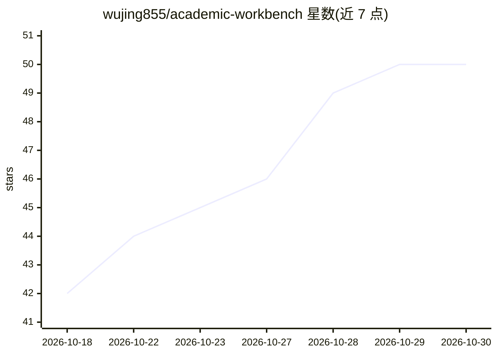

# wujing855/academic-workbench

⭐ 50 · Python · MIT · 推送 2026-09-20 · [GitHub](https://github.com/wujing855/academic-workbench) · 个人维护 · 中文 README

**本地自托管的学术文献工作台：聚合、PDF转写、摘要、精读、日志**

面向本科生、硕士与博士研究者的本地 Web 应用（Python 标准库 server.py，8765 端口），把文献追踪、PDF 转写为 Markdown、AI 摘要卡片、原文-译文-解读三级精读对照、研究日志等 14 个面板串成流水线。数据全部留在本地 data/ 目录。特色部署方式：把一段话发给任意能读写文件的 AI Agent（附 SKILL.md 部署向导），由 Agent 提问 10 项并完成安装配置；不配任何 API Key 时待办、资讯、专注等面板仍可用。PDF 转写分本地 MinerU 3.x 引擎与云端加速两种。

## 筛选速览

| 维度 | 判定 | 备注 |
|---|---|---|
| AI 角色 | `ai-native` | 本体是模型或模型工具 |
| 许可风险 | `permissive` | MIT |
| 部署形态 | `library` | 以包/库形式分发 |
| 模型依赖 | locked-api |  |
| 硬件要求 | — | 无带数字的原话,不猜 |
| 安装摩擦 | `low` | 无编译、无系统依赖或容器化 |
| 成熟度 | — | 结构信号不足 |

## 能力要点

- 14 个面板覆盖资讯聚合、PDF 转写、摘要卡片、精读对照、研究日志
- 通过 SKILL.md 让任意 AI Agent 代为安装与定制（不挑平台）
- 所有数据留在本地 data/ 目录，模型调用走用户自己的 API Key
- PDF 转写提供本地 MinerU 3.x（离线）与云端加速双引擎

## 适用场景

- 每天打开一个页面看领域期刊与热点聚合
- 把英文 PDF 拖进来转写成 Markdown 并生成全文中译与精读对照
- 用结构化摘要卡片记文献要点并链接到研究日志

## 场景标签

`科研工具` `文档解析` · 领域:知识与检索

## 证据(README 行号)

> L3: **一个跑在你自己电脑上的免费学术工作台** —— 本科写毕设、硕士做课题、博士攻论文都能用。
> L78: |读论文|下载 → 手动复制 → 网页翻译|拖进「PDF 转写」→ 自动出 Markdown → 「译文库」全文中译|
> L111: |AI 摘要 / 翻译 / 精读|阿里云百炼（也可 DeepSeek 或其它 OpenAI 兼容服务）|每天有免费 tokens，推荐 `qwen3.8-flash`|`data/llm_config.json`|

## 星数曲线

2026-10-18 42 → 2026-10-30 50（+8）

---
*卡片 v1 · prompt 1.4 · 生成 2026-10-25 · 置信度 mid · 依据 README sha `72e4192e400c` · [字段定义](../../DATASET.md)*
