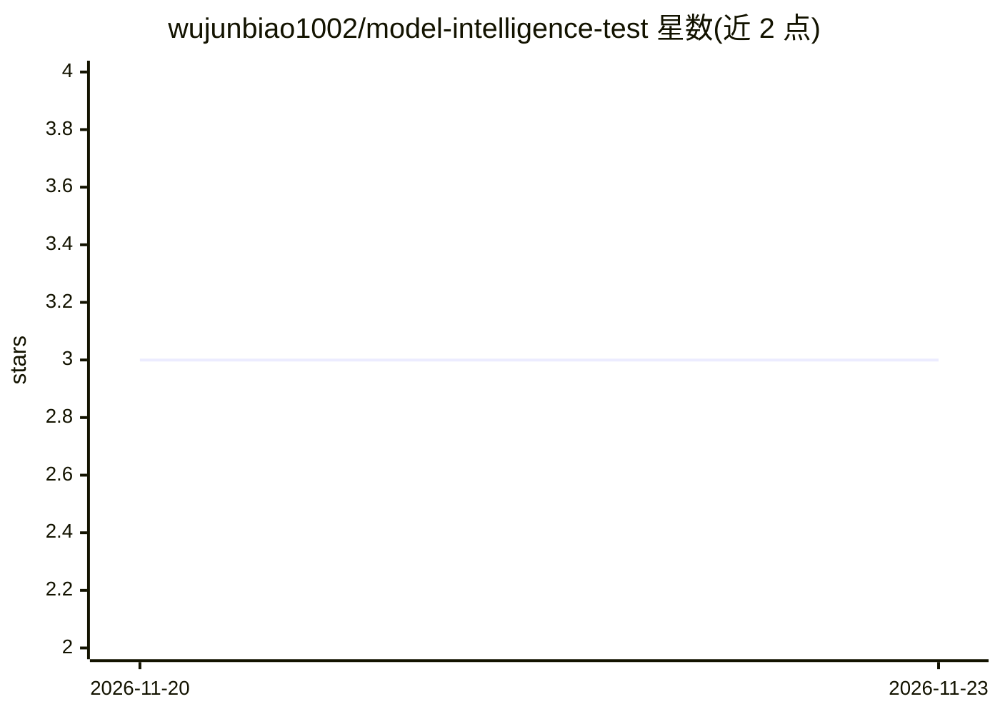

# wujunbiao1002/model-intelligence-test

⭐ 3 · TypeScript · MIT · 推送 2026-10-29 · [GitHub](https://github.com/wujunbiao1002/model-intelligence-test) · [官网](https://tokenhub.junly.top/model-intelligence-test/) · 个人维护 · 中文 README

**定时用鹈鹕骑自行车 SVG 任务检测各模型分组生成能力的静态测试站**

由纯静态前端和定时检测脚本组成：定时脚本调用各模型分组生成 SVG/HTML 作品，页面展示每个分组最近 6 次作品的耗时与成败；浏览器内可选 Key、模型、思考强度并流式生成实时预览，作品保存在 IndexedDB 不上传服务器。必须与 sub2api（OpenAI 兼容网关）部署在同一域名下，通过其 `/api/v1/*` 与 `/v1/*` 路径完成登录与调用；生成结果在 sandbox iframe 中渲染，CSP 阻断网络请求。

## 筛选速览

| 维度 | 判定 | 备注 |
|---|---|---|
| AI 角色 | `ai-ecosystem` | LLM/agent 周边工具 |
| 许可风险 | `permissive` | MIT |
| 部署形态 | `library` | 以包/库形式分发 |
| 模型依赖 | — | README 未给出锁定关系 |
| 硬件要求 | — | 无带数字的原话,不猜 |
| 安装摩擦 | `low` | 无编译、无系统依赖或容器化 |
| 成熟度 | — | 结构信号不足 |

## 能力要点

- 定时脚本用系统 Key 检测各分组模型，未登录也可查看结果
- 浏览器内流式生成并实时预览 SVG/HTML，作品仅存 IndexedDB
- 复用 sub2api 的单点登录跳转参数，读取后从地址栏清除
- 纯静态导出 + cron 检测脚本，无需常驻后台服务

## 适用场景

- 定期查看各模型分组的 SVG/HTML 生成表现与成败记录
- 登录后用自己的 Key 和提示词做生成测试
- 作为 sub2api 网关的可视化测试页面部署在同一域名下

## 场景标签

`模型评测` · 领域:评测与运维

## 证据(README 行号)

> L3: 用“鹈鹕骑自行车”这类 SVG/HTML 生成任务，直观对比各模型分组的生成能力。项目由一个纯静态前端和一个定时检测脚本组成，不需要常驻后台服务，需要搭配 sub2api（OpenAI 兼容的 API 网关）使用。
> L9: 1. **系统检测**：定时脚本用系统 Key 调用各分组模型，页面展示每个分组最近 6 次的作品、耗时和成败，不登录也能看。
> L29: - **部署**：nginx 托管静态文件，cron + Docker（`node:22-alpine`）运行检测脚本

## 星数曲线

2026-11-20 3 → 2026-11-23 3（+0）

---
*卡片 v1 · prompt 1.4 · 生成 2026-11-21 · 置信度 high · 依据 README sha `9659141d4ef7` · [字段定义](../../DATASET.md)*
