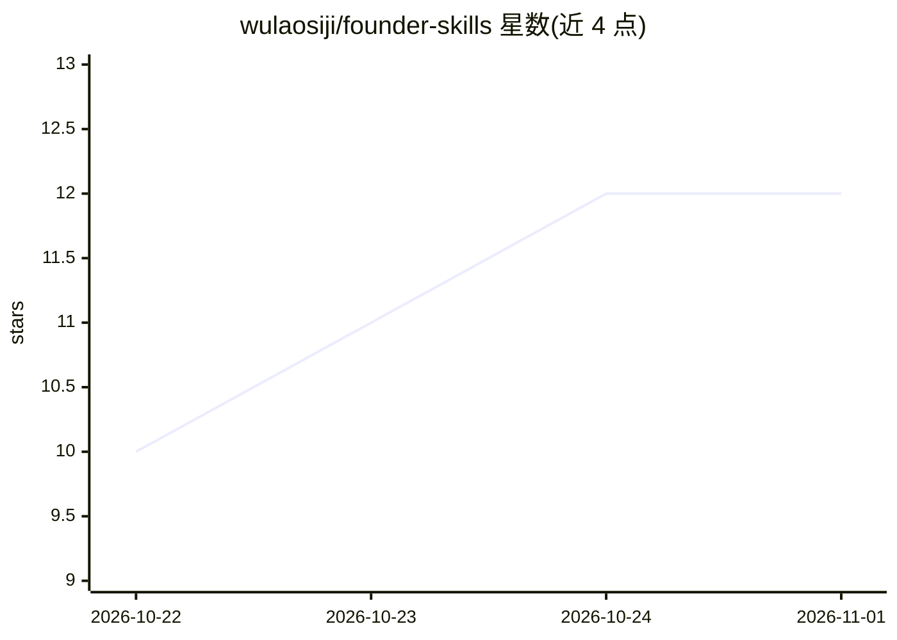

# wulaosiji/founder-skills

⭐ 12 · Python · MIT · 推送 2026-09-09 · [GitHub](https://github.com/wulaosiji/founder-skills) · [官网](https://uniqueclub.ai) · 个人维护 · 中文 README

**给创业者的 24 个 AI agent 技能集：融资 PPT、市场情报与内容创作**

面向初创创始人的 AI agent 技能集合：24 个以 SKILL.md 形式提供的 markdown 技能文件，装入项目后由 Claude Code、Cursor、Codex、Windsurf 等编码 agent 识别触发词并自动调用，覆盖融资路演（多套 BP 框架与 PPTX 生成）、市场情报（竞品追踪、微信/Twitter 监听）、内容创作与日常运营四大类。技能间通过双向交叉引用组成工作流链，unique-club-founder-kit 作为导航层。6 个技能附带可独立运行的 Python 脚本（需 python-pptx、pymupdf 等库）。由个人（吴畏）维护，隶属 UniqueClub 创始人社区。

## 筛选速览

| 维度 | 判定 | 备注 |
|---|---|---|
| AI 角色 | `ai-knowledge` | 知识聚合/清单类 |
| 许可风险 | `permissive` | MIT |
| 部署形态 | `library` | 以包/库形式分发 |
| 模型依赖 | — | README 未给出锁定关系 |
| 硬件要求 | — | 无带数字的原话,不猜 |
| 安装摩擦 | `low` | 无编译、无系统依赖或容器化 |
| 成熟度 | — | 结构信号不足 |

## 能力要点

- 24 个技能通过 7 维质量审计（100/100）
- 融资链路：大纲规划→框架选择→PPTX 生成→HTML 网页转换
- 6 个技能附带可独立运行的 Python 脚本
- 技能间双向交叉引用组成四条工作流链

## 适用场景

- 让 AI 编码助手帮我生成融资 BP 和路演 PPT
- 追踪竞品动态、微信与 Twitter 内容做市场调研
- 把一篇长文改写成多平台社媒内容与 newsletter
- 从会议录音提取行动项并汇入每日简报

## 场景标签

`提示工程` `AI 写作` · 领域:Agent 开发

## 证据(README 行号)

> L13: Skills are markdown files that give AI agents specialized knowledge and workflows for founder-specific tasks. When 
> L15: All 24 skills have passed a 7-dimension quality audit (100/100): naming, description with trigger keywords, usage b

## 星数曲线

2026-10-22 10 → 2026-11-01 12（+2）

---
*卡片 v1 · prompt 1.4 · 生成 2026-10-31 · 置信度 mid · 依据 README sha `05f56caebc51` · [字段定义](../../DATASET.md)*
