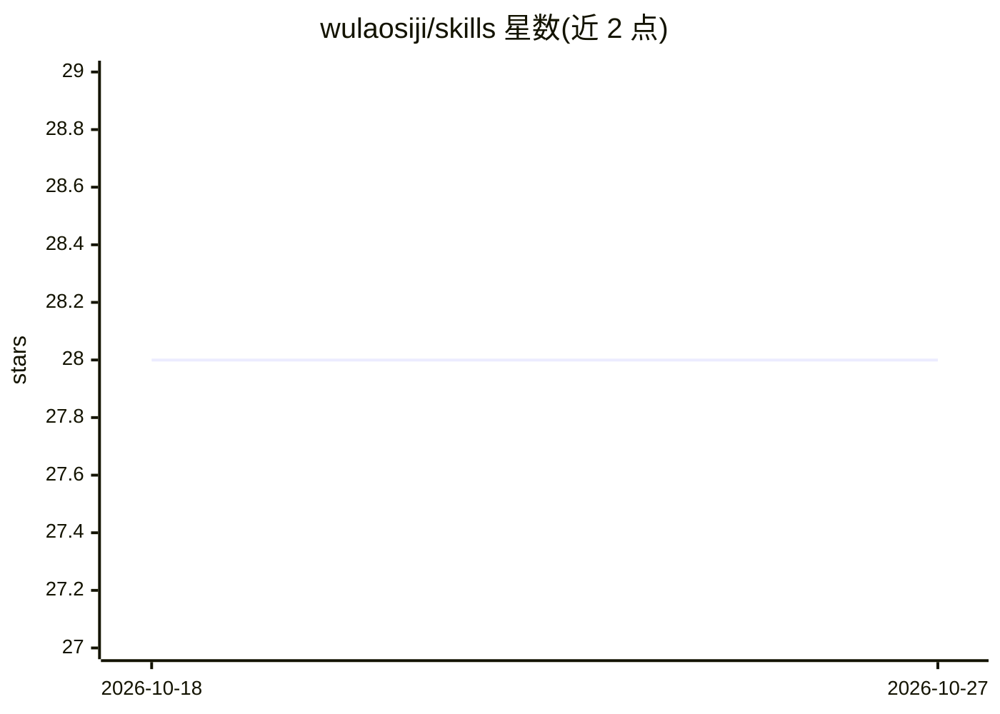

# wulaosiji/skills

⭐ 28 · Python · 推送 2026-10-15 · [GitHub](https://github.com/wulaosiji/skills) · [官网](https://uniqueclub.ai) · 个人维护 · 中文 README

**OpenClaw AI Agent 技能仓库：71 个 SKILL.md 覆盖飞书与工作流自动化**

面向 OpenClaw 的 AI Agent 技能集合仓库：54 个顶层技能（含 12 个嵌套子技能、5 个第三方技能，共 71 个 SKILL.md），按飞书生态（15 个）、内容生成与媒体、数据抓取、系统安全、Agent 平台元能力等 7 类组织。每个技能以 SKILL.md 描述使用边界、工作流与约束，部分附实现脚本。提供 skills CLI（npx skills add）、链接给 Agent 自装和手动 git clone 三种安装方式。5 项商业技能已迁移至 founder-skills，本仓库保留旧版用于兼容。

## 筛选速览

| 维度 | 判定 | 备注 |
|---|---|---|
| AI 角色 | `ai-knowledge` | 知识聚合/清单类 |
| 许可风险 | `none` | — |
| 部署形态 | `library` | 以包/库形式分发 |
| 模型依赖 | — | README 未给出锁定关系 |
| 硬件要求 | — | 无带数字的原话,不猜 |
| 安装摩擦 | `low` | 无编译、无系统依赖或容器化 |
| 成熟度 | — | 结构信号不足 |

## 能力要点

- 71 个 SKILL.md：54 个顶层技能 + 12 个嵌套子技能 + 5 个第三方技能
- 15 个飞书生态技能覆盖文档编排、群聊管理、消息发送、权限管理
- 技能间通过 Related Skills 交叉引用形成飞书文档全链路、安全防护闭环等工作流链路
- 原有 67 个 SKILL.md 按 7 维标准通过质量审计

## 适用场景

- 让我的 AI Agent 获得飞书文档创建、权限管理与消息推送能力
- 为 Agent 配备内容抓取、长文写作、OCR、语音转录等媒体处理技能
- 对 AI Agent 做安全加固、漏洞审计与攻防演练
- 通过 npx skills 命令批量安装所需技能

## 场景标签

 · 领域:AI Agent 技能/办公自动化

## 证据(README 行号)

> L5: > 54 个顶层 AI Agent 技能（另含 12 个嵌套子技能、5 个第三方技能，共 71 个 SKILL.md），覆盖通用工作流、Agent 平台元能力和数据接入。原有 67 个 SKILL.md 的质量审计记录保留；本次迁入
> L13: 技能以 SKILL.md 描述使用边界、工作流、输出和约束；有脚本的技能在各自目录中提供实现。原有技能的 7 维质量审计记录见下文。

## 星数曲线

2026-10-18 28 → 2026-10-27 28（+0）

---
*卡片 v1 · prompt 1.4 · 生成 2026-10-26 · 置信度 high · 依据 README sha `56ad6eb7a79d` · [字段定义](../../DATASET.md)*
