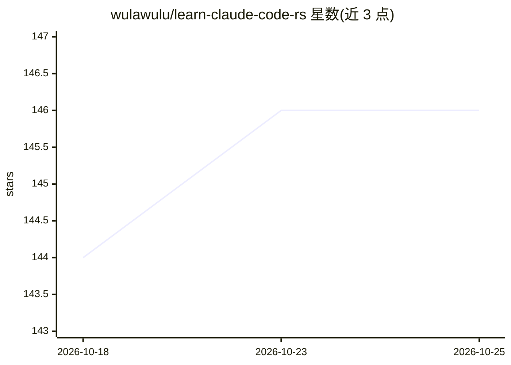

# wulawulu/learn-claude-code-rs

⭐ 146 · Rust · MIT · 推送 2026-10-19 · [GitHub](https://github.com/wulawulu/learn-claude-code-rs) · 个人维护 · 中文 README

**Rust 编写的渐进式 AI Agent Harness 教程（21 章 + 完整版）**

面向想理解 coding agent 内部实现的开发者，用 Rust 逐步构建 agent harness：从最小 agent loop 出发，逐章加入工具、规划、子 agent、技能加载、上下文压缩、权限、hooks、记忆、多 agent 团队、worktree 隔离、MCP 插件与类型化工具路由，最终整合为 sfull 完整版。每章是独立可运行的 crate，通过环境变量配置 Anthropic 兼容 SDK 接口的模型 API。项目受 shareAI-lab/learn-claude-code 启发，为面向 Rust 生态的重组织教程，MIT 许可。

## 筛选速览

| 维度 | 判定 | 备注 |
|---|---|---|
| AI 角色 | `ai-knowledge` | 知识聚合/清单类 |
| 许可风险 | `permissive` | MIT |
| 部署形态 | `None` |  |
| 模型依赖 | — | README 未给出锁定关系 |
| 硬件要求 | — | 无带数字的原话,不猜 |
| 安装摩擦 | `low` | 无编译、无系统依赖或容器化 |
| 成熟度 | — | 结构信号不足 |

## 能力要点

- 21 个独立可运行章节 + 完整整合版 sfull
- 覆盖子 agent、记忆、多 agent 团队、worktree 隔离、MCP 插件、工具路由
- 示例使用 Anthropic 兼容 SDK 接口，通过 .env 配置 API
- 含 agent evaluation 章（eval 用例、确定性断言、LLM-as-a-Judge）

## 适用场景

- 我想学习 Claude Code 类 coding agent 的内部运行机制
- 用 Rust 从零构建自己的 AI agent 或 CLI 自动化工具
- 理解工具分发、权限、上下文压缩等 agent 工程结构

## 场景标签

`教程课程` · 领域:学习与行业

## 证据(README 行号)

> L6: A progressive AI Agent Harness tutorial written in Rust.
> L8: This repository is a Rust-oriented learning path for building an agent harness. It starts with the smallest agent lo
> L12: Each chapter is an independent runnable Rust crate. You can read them in order or jump directly into a topic to see

## 星数曲线

2026-10-18 144 → 2026-10-25 146（+2）

---
*卡片 v1 · prompt 1.4 · 生成 2026-10-22 · 置信度 high · 依据 README sha `4af962d026b9` · [字段定义](../../DATASET.md)*
