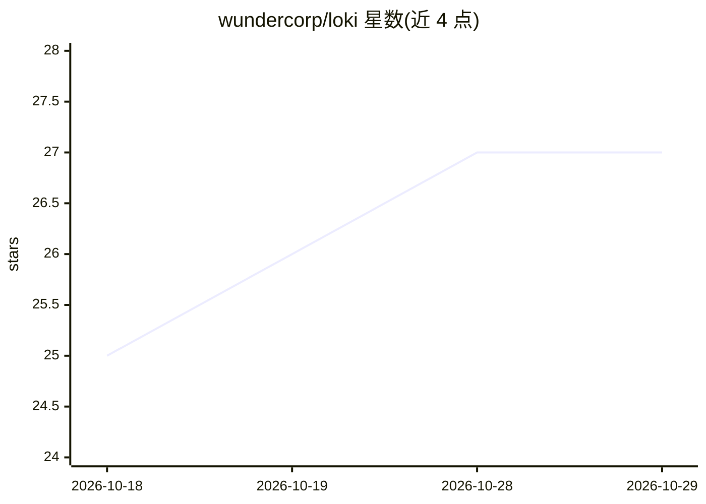

# wundercorp/loki

⭐ 27 · Python · MIT · 推送 2026-10-26 · [GitHub](https://github.com/wundercorp/loki) · [官网](https://loki.computer) · 组织维护 · 中文 README

**自我改进的个人 AI agent：学习循环+多平台消息接入**

WunderCorp 开发的命令行 AI agent，核心机制是学习闭环：从任务经验自主创建技能并在使用中改进，维护持久化记忆与用户模型（Honcho dialectic），支持 FTS5 会话搜索。可接入 OpenRouter、OpenAI、Anthropic 等多种模型并随时切换。通过单一 gateway 进程连接 Telegram、Discord、Slack、WhatsApp、Signal 等消息平台；内置 cron 定时任务、子 agent 并行、MCP 集成，支持七种终端后端（本地、Docker、SSH、Modal、Daya 等）。Linux/macOS/WSL2/Termux 用 curl 安装脚本，Windows 原生 PowerShell 安装。

## 筛选速览

| 维度 | 判定 | 备注 |
|---|---|---|
| AI 角色 | `ai-native` | 本体是模型或模型工具 |
| 许可风险 | `permissive` | MIT |
| 部署形态 | `desktop` | 安装包/桌面程序 |
| 模型依赖 | locked-api |  |
| 硬件要求 | — | 无带数字的原话,不猜 |
| 安装摩擦 | `medium` | 含编译或系统依赖之一 |
| 成熟度 | — | 结构信号不足 |

## 能力要点

- 学习闭环：任务后自主创建技能，技能在使用中自我改进
- 单一 gateway 进程接入 Telegram/Discord/Slack/WhatsApp/Signal 多平台
- 七种终端后端：本地、Docker、SSH、Singularity、Modal、Daytona、Vercel Sandbox
- 内置 cron 调度器与 MCP 集成，支持 OpenClaw 迁移

## 适用场景

- 通过 Telegram 等消息平台随时与云端运行的 agent 对话
- 让 agent 执行任务并沉淀为可复用、可自我改进的技能
- 用自然语言设定定时报告、备份等无人值守自动化

## 场景标签

`AI 助手` `Agent 记忆` · 领域:Agent 开发

## 证据(README 行号)

> L15: **The self-improving AI agent built by WunderCorp, Inc..** It's the only agent with a built-in learning loop — it c
> L17: Use any model you want — OpenRouter, OpenAI, your own endpoint, and many others. Switch with `loki model` — no code
> L20:  Lives where you do Telegram, Discord, Slack, WhatsApp, Signal, and CLI — all from a single gateway process. Voice 

## 星数曲线

2026-10-18 25 → 2026-10-29 27（+2）

---
*卡片 v1 · prompt 1.4 · 生成 2026-10-26 · 置信度 mid · 依据 README sha `7fdc3a337cc7` · [字段定义](../../DATASET.md)*
