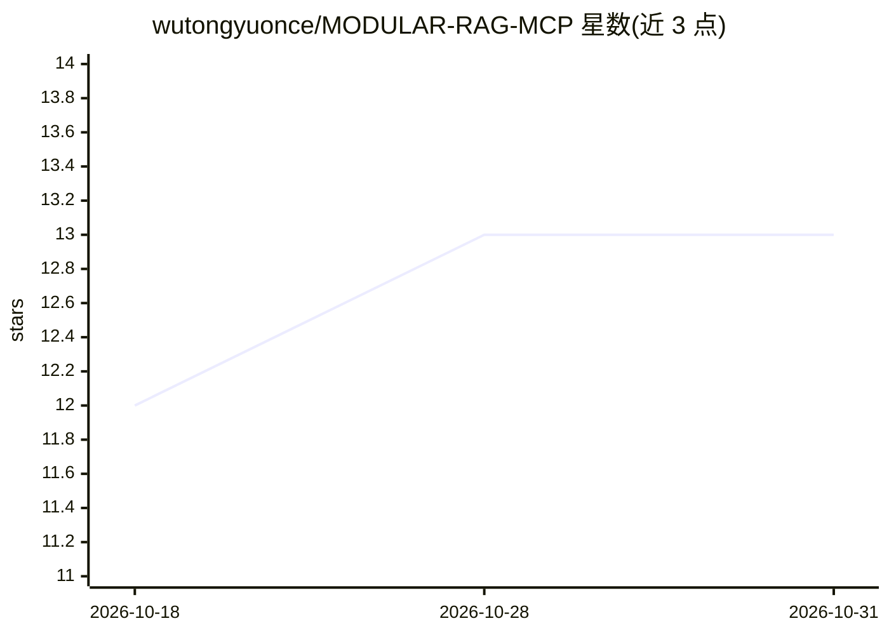

# wutongyuonce/MODULAR-RAG-MCP

⭐ 13 · Python · 推送 2026-08-07 · [GitHub](https://github.com/wutongyuonce/MODULAR-RAG-MCP) · 个人维护 · 中文 README

**面向大模型岗位学习与求职的模块化 RAG MCP 服务框架**

可插拔、可观测的模块化 RAG 框架：通过 MCP 协议向 GitHub Copilot / Claude Desktop 等 AI 助手暴露 query_knowledge_hub、list_collections 等工具接口。链路覆盖 PDF 摄取、BM25+Dense 混合检索与重排、查询编排、Vision LLM 图片描述、Ragas 评估，LLM/Embedding/Reranker/VectorStore 均定义抽象接口可配置切换。同时提供 Streamlit 六页面管理平台，以及 Resume Writer 等 Agent Skill 与配套教学资源。以 git clone 源码方式运行，配置通过 Setup Skill 引导完成。

## 筛选速览

| 维度 | 判定 | 备注 |
|---|---|---|
| AI 角色 | `ai-ecosystem` | LLM/agent 周边工具 |
| 许可风险 | `none` | — |
| 部署形态 | `None` |  |
| 模型依赖 | local-ok | 支持本地模型 |
| 硬件要求 | — | 无带数字的原话,不猜 |
| 安装摩擦 | `low` | 无编译、无系统依赖或容器化 |
| 成熟度 | — | 结构信号不足 |

## 能力要点

- MCP 协议暴露工具接口，对接 Copilot / Claude Desktop 等 MCP Client
- BM25+Dense 混合检索、RRF 融合与 Cross-Encoder/LLM Rerank
- LLM/Embedding/Reranker/Splitter/VectorStore 全链路可插拔抽象接口
- Ragas+Custom 评估体系与 Streamlit 六页面可观测平台

## 适用场景

- 为自己的知识库搭建可被 AI 助手直接调用的检索服务
- 学习 RAG 全链路工程实现并作为面试求职项目
- 通过混合检索与评估回归机制迭代文档问答质量

## 场景标签

`RAG` `文档问答` `教程课程` · 领域:知识与检索

## 证据(README 行号)

> L13: 本项目将 RAG 面试中最常见的核心环节——**检索（Hybrid Search + Rerank）**、**多模态视觉处理（Image Captioning）**、**RAG 评估（Ragas + Custom）**、**生成（
> L35: |**MCP Server**|标准 MCP 协议暴露 Tools|`query_knowledge_hub`、`list_collections`、`get_document_summary`|

## 星数曲线

2026-10-18 12 → 2026-10-31 13（+1）

---
*卡片 v1 · prompt 1.4 · 生成 2026-10-31 · 置信度 high · 依据 README sha `f1cc1126f9ff` · [字段定义](../../DATASET.md)*
