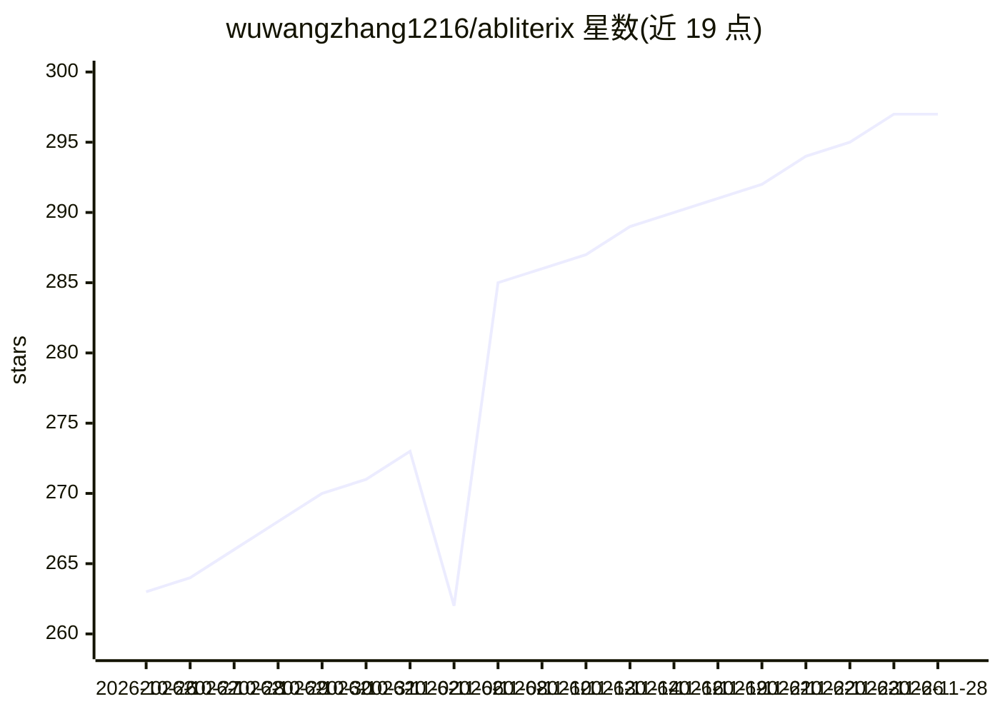

# wuwangzhang1216/abliterix

⭐ 297 · Python · AGPL-3.0 · 推送 2026-11-17 · [GitHub](https://github.com/wuwangzhang1216/abliterix) · 个人维护

**为 LLM 自动搜索最优 abliteration 参数的模型编辑工具**

Abliterix 用 Optuna TPE 多目标优化自动搜索 abliteration 参数，在降低模型拒绝率的同时最小化与原模型的 KL 散度。流程为提取各层激活、推导拒绝方向、以 LoRA/权重投影/运行时 steering 应用编辑、评估取舍并自动搜索层位置与强度。支持 dense、MoE、SSM/hybrid 与视觉语言架构，内置 150+ 预置配置；提供可复现 manifest、精确重放命令与公开基准。AGPL v3 许可，声明为实验性研究软件并附安全免责声明。

## 筛选速览

| 维度 | 判定 | 备注 |
|---|---|---|
| AI 角色 | `ai-ecosystem` | LLM/agent 周边工具 |
| 许可风险 | `viral` | AGPL-3.0 |
| 部署形态 | `library` | 以包/库形式分发 |
| 模型依赖 | — | README 未给出锁定关系 |
| 硬件要求 | — | 无带数字的原话,不猜 |
| 安装摩擦 | `medium` | 含编译或系统依赖之一 |
| 成熟度 | `idea` | |

## 能力要点

- Optuna TPE 多目标优化拒绝率与 KL 散度的 Pareto 前沿
- 支持 LoRA、直接权重投影、运行时 steering 及 MoE 专家粒度编辑
- 150+ 预置配置覆盖 4 类架构、20+ 模型家族
- 可复现 manifest（schema v2）与 --reproduce 精确重放

## 适用场景

- 对开源 LLM 自动化执行 abliteration 而无需手工调参
- 复现并审计他人发布的 abliterated 模型结果
- 研究不同 steering/拒绝方向方法在多架构上的效果

## 场景标签

`模型量化` `模型评测` · 领域:评测与运维

## 证据(README 行号)

> L12: **Abliterix** finds the optimal abliteration parameters for any transformer model using Optuna TPE optimization. It
> L86: 3. **Apply candidate edits** — modify attention, MLP, and, where applicable, MoE expert/router components using rev
> L88: 5. **Optimize automatically** — use Optuna TPE to search layer locations, component strengths, decay profiles, vect

## 星数曲线

2026-10-26 263 → 2026-11-28 297（+34）

---
*卡片 v1 · prompt 1.4 · 生成 2026-11-25 · 置信度 high · 依据 README sha `a706a5ec087d` · [字段定义](../../DATASET.md)*
