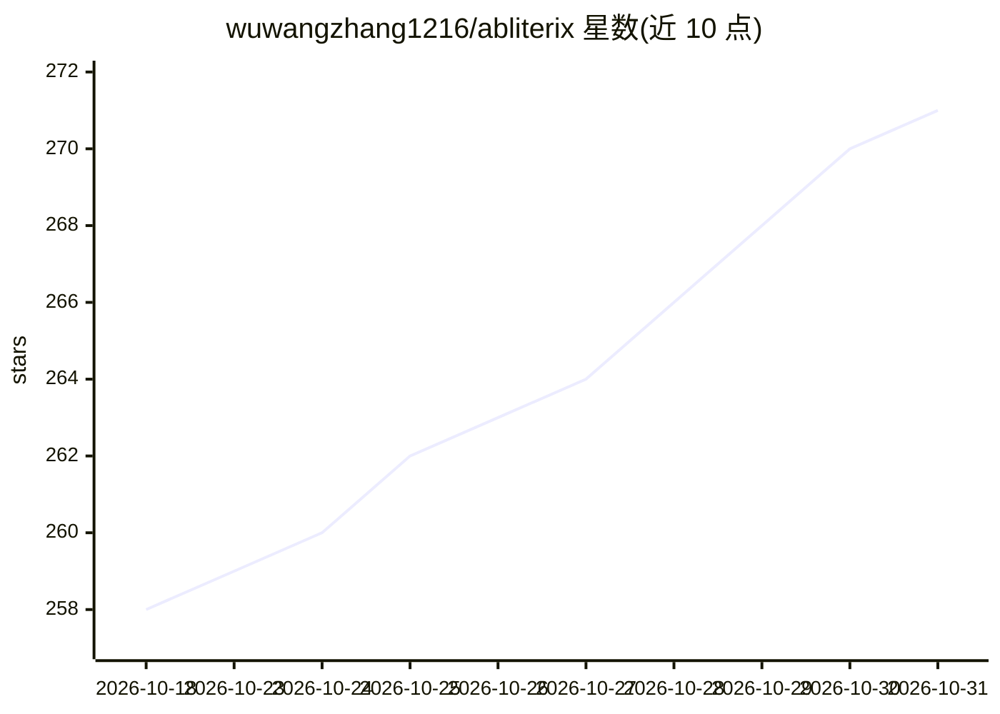

# wuwangzhang1216/abliterix

⭐ 271 · Python · AGPL-3.0 · 推送 2026-09-28 · [GitHub](https://github.com/wuwangzhang1216/abliterix) · 个人维护

**LLM 拒绝行为消除的自动调参工具：Optuna 搜索最优 abliteration 参数**

面向 LLM 模型编辑的 Python 库与 CLI：提取良性/目标提示的激活差分得到拒绝方向，通过直接投影、LoRA 或 MoE 专家级编辑修改权重，用 Optuna TPE 多目标搜索在降低拒绝率与 KL 散度之间求 Pareto 前沿，支持 Dense/MoE/SSM/视觉语言 4 类架构与 150+ 预置配置。附可复现基准 HonestAbliterationBench 与双语评测数据集。README 明确声明为实验性研究软件，修改会削弱模型安全防护，使用者需自行承担合规与部署责任。

## 筛选速览

| 维度 | 判定 | 备注 |
|---|---|---|
| AI 角色 | `ai-ecosystem` | LLM/agent 周边工具 |
| 许可风险 | `viral` | AGPL-3.0 |
| 部署形态 | `library` | 以包/库形式分发 |
| 模型依赖 | local-ok | 支持本地模型 |
| 硬件要求 | — | 无带数字的原话,不猜 |
| 安装摩擦 | `medium` | 含编译或系统依赖之一 |
| 成熟度 | `idea` | |

## 能力要点

- Optuna TPE 多目标搜索自动寻找 abliteration 参数（拒绝率 vs KL 散度）
- 支持 Dense、MoE（专家/路由级编辑）、SSM/混合、视觉语言四类架构，150+ 预置配置
- 可复现清单（commit 固定 + SHA256 权重校验）与 --replay 精确复现实验
- 4/8-bit 量化与 FP4 原生重打包以降低显存占用

## 适用场景

- 自动化调整开源模型的对齐/拒绝行为并导出修改后权重
- 研究模型内部拒绝机制与反制手段的科研实验
- 以固定契约评测 abliterated 模型的拒绝率与漂移

## 场景标签

`科研工具` · 领域:学习与行业

## 证据(README 行号)

> L12: **Abliterix** finds the optimal abliteration parameters for any transformer model using Optuna TPE optimization. It
> L86: 3. **Apply candidate edits** — modify attention, MLP, and, where applicable, MoE expert/router components using rev
> L88: 5. **Optimize automatically** — use Optuna TPE to search layer locations, component strengths, decay profiles, vect

## 星数曲线

2026-10-18 258 → 2026-10-31 271（+13）

---
*卡片 v1 · prompt 1.4 · 生成 2026-10-22 · 置信度 high · 依据 README sha `fabdac3d1902` · [字段定义](../../DATASET.md)*
