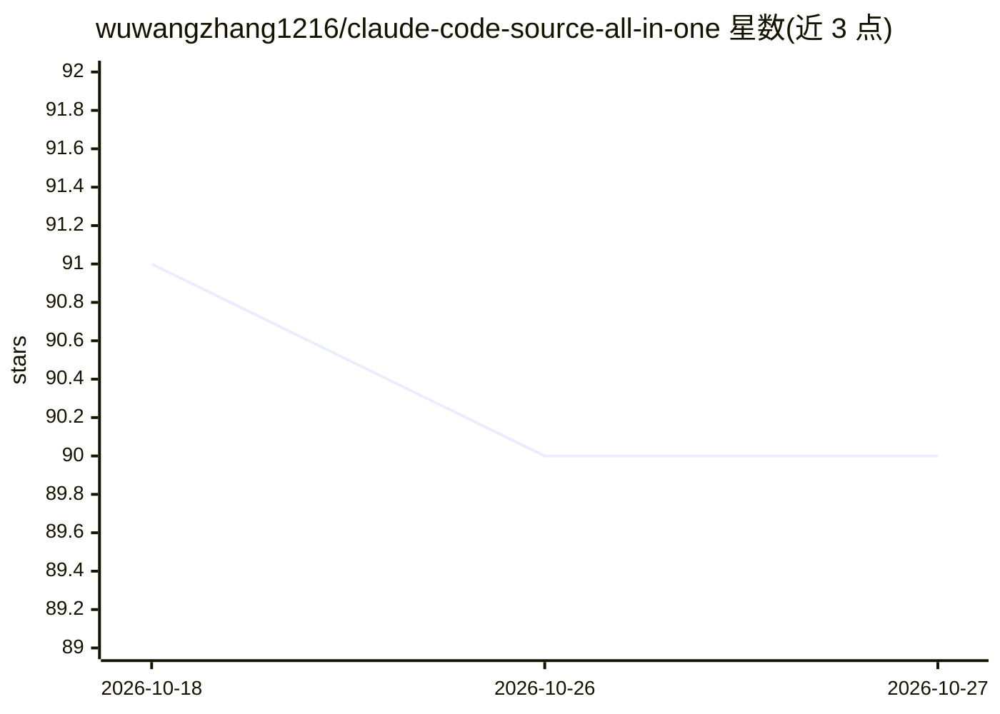

# wuwangzhang1216/claude-code-source-all-in-one

⭐ 90 · TypeScript · 推送 2026-05-28 · [GitHub](https://github.com/wuwangzhang1216/claude-code-source-all-in-one) · 个人维护 · 中文 README

**Claude Code 源码镜像+18篇架构解析文章，可本地从源码运行**

收录从公开渠道提取的 Claude Code v2.1.123 源码，并附 18 篇中英双语架构深度解析文章（覆盖主循环、流式、工具编排、权限系统、子代理、MCP、上下文压缩等）。通过逆向出的 package.json、shim 文件与 setup 脚本使源码可本地运行（功能有删减：Computer Use、Chrome 集成等因私有包缺失不可用，89 个 feature flag 全部禁用）。认证支持 Claude 订阅/API key、ChatGPT 订阅、OpenAI 兼容提供商及本地 Ollama。声明知识产权归 Anthropic，仅供教育研究，禁止商用与再分发。

## 筛选速览

| 维度 | 判定 | 备注 |
|---|---|---|
| AI 角色 | `ai-native` | 本体是模型或模型工具 |
| 许可风险 | `none` | — |
| 部署形态 | `library` | 以包/库形式分发 |
| 模型依赖 | local-ok | 支持本地模型 |
| 硬件要求 | — | 无带数字的原话,不猜 |
| 安装摩擦 | `low` | 无编译、无系统依赖或容器化 |
| 成熟度 | — | 结构信号不足 |

## 能力要点

- Claude Code v2.1.123 提取源码，跟随上游版本更新
- 18 篇中英双语架构深度解析文章
- 逆向 100+ 依赖并生成 shim，支持从源码运行（功能有删减）
- 支持 Claude 订阅、ChatGPT 订阅、OpenAI 兼容 API 与本地 Ollama 作为模型来源

## 适用场景

- 研究生产级 AI agent 的工程架构与设计模式
- 从源码运行 Claude Code 并观察其内部行为
- 通过 18 篇解析文章系统学习 agent 子系统实现

## 场景标签

`编码 Agent` `教程课程` · 领域:编码与开发

## 证据(README 行号)

> L14: This repository contains the **extracted source code** of Claude Code (Anthropic's AI programming CLI) along with *
> L110: ## Run from Source
> L187:  Alternative: Run a local model via Ollama (offline / no API key)

## 星数曲线

2026-10-18 91 → 2026-10-27 90（-1）

---
*卡片 v1 · prompt 1.4 · 生成 2026-10-23 · 置信度 mid · 依据 README sha `12f2fc8c3fe9` · [字段定义](../../DATASET.md)*
