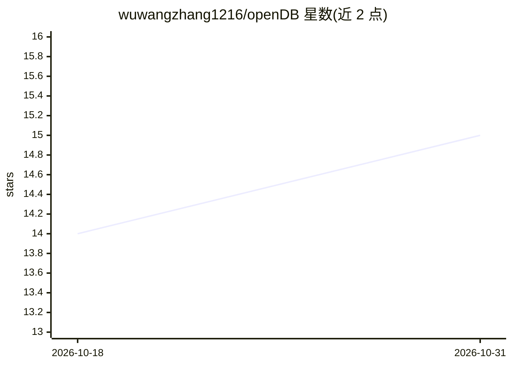

# wuwangzhang1216/openDB

⭐ 15 · Python · MIT · 推送 2026-06-18 · [GitHub](https://github.com/wuwangzhang1216/openDB) · [官网](https://opendb-ai.com/) · 个人维护

**面向 AI agent 的本地数据库：文件读取、检索与长期记忆**

以 SQLite FTS5 为存储后端的本地数据库，为编程 agent 提供长期记忆：通过 MCP 协议暴露 12 个工具，支持读取代码/PDF/表格等文件、跨工作区全文与 grep 检索、三类记忆（语义/情景/程序性）的存取与遗忘、多工作区切换。不使用 embedding API 与向量数据库，采用 BM25 关键词检索加时间衰减重排与冲突检测。以 pip 包与 CLI 提供，需 Python 3.11+。README 给出 CodeMemEval 与 LongMemEval 两套基准结果及与多个记忆系统的对比表。

## 筛选速览

| 维度 | 判定 | 备注 |
|---|---|---|
| AI 角色 | `ai-ecosystem` | LLM/agent 周边工具 |
| 许可风险 | `permissive` | MIT |
| 部署形态 | `self-host` | docker 或自建部署 |
| 模型依赖 | — | README 未给出锁定关系 |
| 硬件要求 | — | 无带数字的原话,不猜 |
| 安装摩擦 | `low` | 无编译、无系统依赖或容器化 |
| 成熟度 | — | 结构信号不足 |

## 能力要点

- MCP 协议提供 12 个工具：文件读取、代码/文档检索、记忆存取与遗忘
- 基于 SQLite FTS5 的 BM25 检索，无 embedding API 与向量数据库
- semantic/episodic/procedural 三类记忆与 pinned 置顶机制
- 多工作区运行时切换，提供各主流 agent 框架接入示例

## 适用场景

- 给编程 agent 增加跨会话的架构决策与约定记忆
- 让 agent 用统一工具读取 PDF/表格/代码而不写解析代码
- 在多个项目工作区之间切换并共享 MCP 工具集

## 场景标签

`Agent 记忆` `文档解析` · 领域:Agent 开发

## 证据(README 行号)

> L24: That's it. Your agent now has 12 MCP tools — read any file format, search across documents and code, store/recall p
> L119: OpenDB speaks MCP — the universal standard supported by all major frameworks. Pick yours:

## 星数曲线

2026-10-18 14 → 2026-10-31 15（+1）

---
*卡片 v1 · prompt 1.4 · 生成 2026-10-30 · 置信度 mid · 依据 README sha `05dde48d8e35` · [字段定义](../../DATASET.md)*
