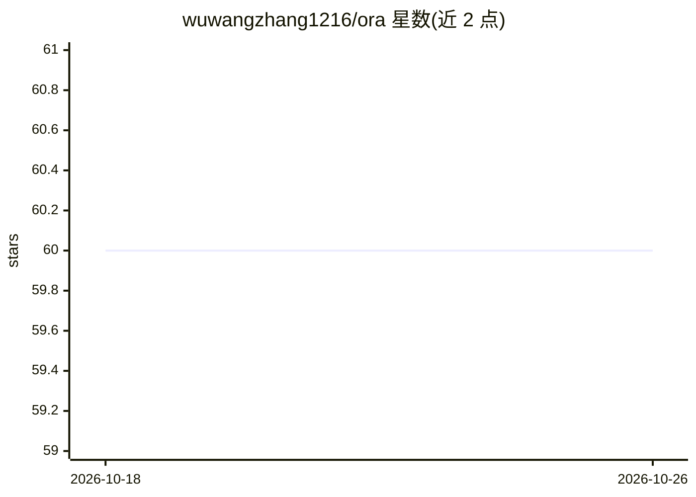

# wuwangzhang1216/ora

⭐ 60 · Swift · MIT · 推送 2026-10-22 · [GitHub](https://github.com/wuwangzhang1216/ora) · [官网](https://main.d1cdtuylr567og.amplifyapp.com/) · 个人维护 · 中文 README

**macOS 菜单栏实时本地语音翻译应用**

面向 macOS 用户的菜单栏应用：监听麦克风，经设备端 VAD、ASR（Qwen3-ASR-1.7B）与 MLX 翻译模型（Qwen3.5），在悬浮字幕卡中实时流式显示源文与译文，全流程跑在 Apple Silicon 的 Metal GPU 上，无云端调用、无 API key、无遥测。支持中/英/日/韩/法/德/西等多语言互译，提供三档质量层级、房间 VAD 预设、转写历史导出（TXT/SRT/JSON/Markdown）。要求 macOS 15+ 与 Apple Silicon；另附同架构的 Python 参考 CLI，默认后端为 Ollama。v0.8.0 签名但未公证，首次启动可能被系统拦截。

## 筛选速览

| 维度 | 判定 | 备注 |
|---|---|---|
| AI 角色 | `ai-native` | 本体是模型或模型工具 |
| 许可风险 | `permissive` | MIT |
| 部署形态 | `desktop` | 安装包/桌面程序 |
| 模型依赖 | local-ok | 支持本地模型 |
| 硬件要求 | — | 无带数字的原话,不猜 |
| 安装摩擦 | `low` | 无编译、无系统依赖或容器化 |
| 成熟度 | — | 结构信号不足 |

## 能力要点

- Silero VAD + 设备端 ASR + MLX 翻译全本地流水线（Metal GPU）
- 流式字幕：边说边显示源文并逐 token 翻译
- 三档质量层级（约 1.2/3/6 GB 模型下载）与房间 VAD 预设
- 转写历史窗口，可导出 TXT/SRT/JSON/Markdown

## 适用场景

- 跨语言会议中实时看双语字幕（含捕获系统音频给 Zoom 参会者加字幕）
- 本地隐私优先的实时语音翻译，不联网不传数据
- 回看与导出历史会话转写和字幕文件

## 场景标签

`语音识别` · 领域:感知与多模态

## 证据(README 行号)

> L17: Ora listens to your microphone and streams live translations of what you say into a floating caption window, using 
> L19: - 🎙 **Native real-time**: on-device voice activity detection, speech recognition, and translation, all on the Metal
> L20: - 🔒 **100% local**: no network calls after the one-time model download, no API keys, no telemetry

## 星数曲线

2026-10-18 60 → 2026-10-26 60（+0）

---
*卡片 v1 · prompt 1.4 · 生成 2026-10-24 · 置信度 mid · 依据 README sha `d047e3479590` · [字段定义](../../DATASET.md)*
