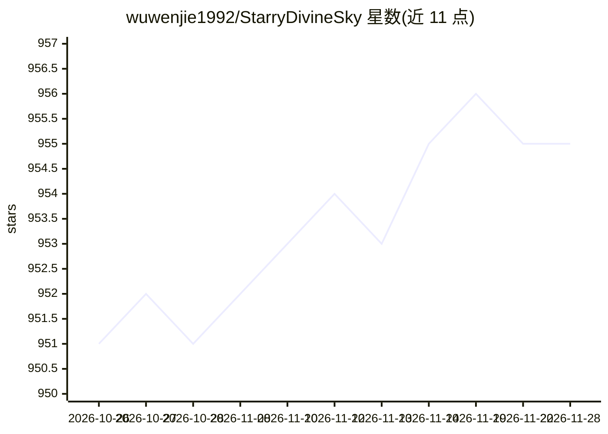

# wuwenjie1992/StarryDivineSky

⭐ 955 · NOASSERTION · 推送 2026-11-01 · [GitHub](https://github.com/wuwenjie1992/StarryDivineSky) · [官网](https://www.wuwenjie.xyz) · 个人维护 · 中文 README

**收录10K+开源项目的AI/ML精选清单**

以 awesome-list 形式持续收录超过一万个开源项目，按机器学习与深度学习（教程、分布式训练、参数优化、异常检测、NAS）、NLP（文本生成、对话模型、Agent、LLM评测、垂直领域大模型、RAG）等分类目录组织。README 仅展示近两个月新增的前256个项目，完整内容需 clone 后阅读或搜索；提供 Discord 社区入口，持续更新。收录对象覆盖模型、工具库、教程与求职信息聚合等多种类型。

## 筛选速览

| 维度 | 判定 | 备注 |
|---|---|---|
| AI 角色 | `ai-knowledge` | 知识聚合/清单类 |
| 许可风险 | `none` | NOASSERTION |
| 部署形态 | `None` |  |
| 模型依赖 | — | README 未给出锁定关系 |
| 硬件要求 | — | 无带数字的原话,不猜 |
| 安装摩擦 | `low` | 无编译、无系统依赖或容器化 |
| 成熟度 | — | 结构信号不足 |

## 能力要点

- 收录超过 10K 个开源项目的分类清单
- 按机器学习、NLP、GNN、推荐系统、生物医药、机器视觉等主题分类
- README 仅展示近两月新增前256项，完整列表需 clone 后检索
- 提供 Discord 社区入口并持续更新

## 适用场景

- 按领域查找机器学习、NLP 等方向的开源项目
- 跟踪近期新增的 LLM 与 Agent 相关仓库
- clone 后按关键词搜索特定主题的项目

## 场景标签

`精选清单` · 领域:学习与行业

## 证据(README 行号)

> L16:  精选了10K+项目，包括机器学习、深度学习、NLP、GNN、推荐系统、生物医药、机器视觉等内容。
> L22: # 目录
> L25: * README 文件仅展示了仅两个月新增的前256个git项目。The README file only shows the first 256 git projects added in just 2 month.

## 星数曲线

2026-10-26 951 → 2026-11-28 955（+4）

---
*卡片 v1 · prompt 1.4 · 生成 2026-11-24 · 置信度 high · 依据 README sha `87c9be63c17c` · [字段定义](../../DATASET.md)*
