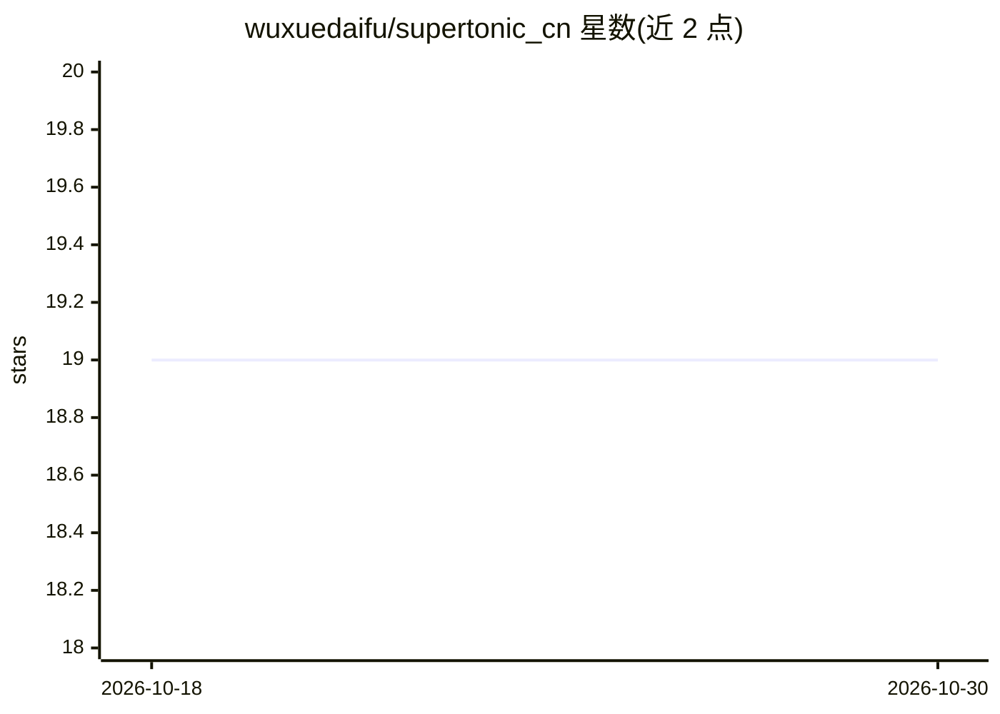

# wuxuedaifu/supertonic_cn

⭐ 19 · Python · MIT · 推送 2026-08-15 · [GitHub](https://github.com/wuxuedaifu/supertonic_cn) · 个人维护 · 中文 README

**Supertonic-3 的中文微调扩展：纯 ONNX 设备端普通话 TTS**

基于公开的 Supertonic-3 模型构建的中文普通话 TTS 扩展，以融合优化的 ONNX 图分发，推理仅依赖 ONNX Runtime（无 PyTorch），上游声码器冻结不动。支持普通话声调、多音字、儿化与文本正则化（日期/金额/百分比/电话号码读法），并提供流式合成（按子句边界切分、支持 barge-in 与异步接口）。权重在 Hugging Face 门控发放，当前构建为非商用评估许可；仅单一预置音色，中英混读被声明为不可靠，作者称其为可行性演示而非成品。

## 筛选速览

| 维度 | 判定 | 备注 |
|---|---|---|
| AI 角色 | `ai-native` | 本体是模型或模型工具 |
| 许可风险 | `permissive` | MIT |
| 部署形态 | `library` | 以包/库形式分发 |
| 模型依赖 | — | README 未给出锁定关系 |
| 硬件要求 | — | 无带数字的原话,不猜 |
| 安装摩擦 | `medium` | 含编译或系统依赖之一 |
| 成熟度 | `idea` | |

## 能力要点

- 纯 ONNX Runtime 推理的普通话 TTS（无 PyTorch 依赖）
- 文本正则化：日期/金额/百分比/电话号码读为口语中文
- 流式合成：首包延迟中位数 245 ms（A100）/ 757 ms（CPU），支持 barge-in
- 公开 100 句测试集与逐类 CER 分解（评测由 Whisper-small 判分）

## 适用场景

- 在设备端离线合成普通话语音
- 为 LLM 对话输出做低延迟流式语音播报
- 需要日期、金额等中文数字读法自然的应用

## 场景标签

`语音合成` · 领域:内容生成

## 证据(README 行号)

> L19: The official **Supertonic-3** is a fast, lightweight, on-device TTS family — but out of the box it **does not synth
> L76: The Mandarin model ships as **fused / optimized ONNX graphs**, gated on Hugging Face — **🤗 dove88/supertonic-zh** (

## 星数曲线

2026-10-18 19 → 2026-10-30 19（+0）

---
*卡片 v1 · prompt 1.4 · 生成 2026-10-28 · 置信度 mid · 依据 README sha `1b0abc2dccd7` · [字段定义](../../DATASET.md)*
