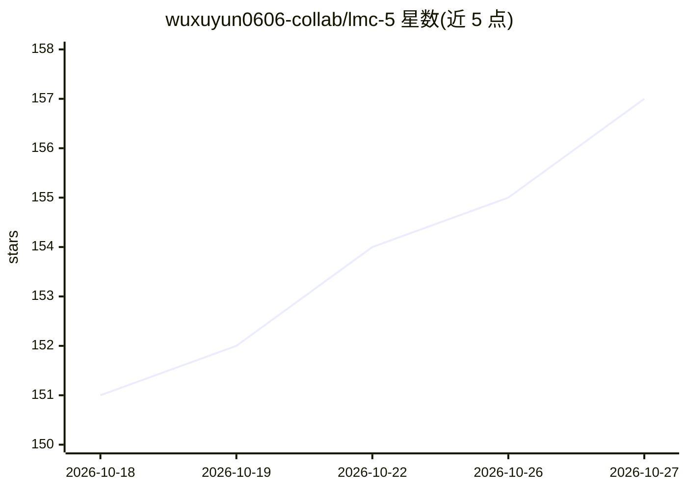

# wuxuyun0606-collab/lmc-5

⭐ 157 · Python · AGPL-3.0 · 推送 2026-10-23 · [GitHub](https://github.com/wuxuyun0606-collab/lmc-5) · 个人维护 · 中文 README

**为长期运行 LLM agent 提供五轴记忆架构与可恢复记忆层**

面向 Claude Code、Codex 类编码 agent 与个人助手 agent 的离线优先记忆层：将记忆组织为 X 时间线、Y 关系、Z 事实演化、E 经验信号、M 代谢五轴，底层保留原始事件日志，通过 surface() 输出脱敏上下文。提供两套参考实现：SQLite 最小版（FTS5+余弦检索、零依赖）与 PostgreSQL/pgvector 生产版（三级级联回忆、LLM 海马体、Claude Code hooks、cron 夜间任务）。核心不做网络调用、不绑定模型厂商，以本地 CLI 与 Python API 形式提供。

## 筛选速览

| 维度 | 判定 | 备注 |
|---|---|---|
| AI 角色 | `ai-ecosystem` | LLM/agent 周边工具 |
| 许可风险 | `viral` | AGPL-3.0 |
| 部署形态 | `library` | 以包/库形式分发 |
| 模型依赖 | — | README 未给出锁定关系 |
| 硬件要求 | — | 无带数字的原话,不猜 |
| 安装摩擦 | `low` | 无编译、无系统依赖或容器化 |
| 成熟度 | — | 结构信号不足 |

## 能力要点

- X/Y/Z/E/M 五轴记忆模型，区分原始事件与精选记忆
- SQLite 零依赖最小版 + PostgreSQL/pgvector 生产版双实现
- 两跳类型化关系扩展、事实键更替与 Z 轴冲突审计
- 核心无网络调用、厂商无关，支持 Claude Code hooks / MCP sidecar / shell 包装集成

## 适用场景

- 让编码 agent 跨会话恢复项目上下文
- VPS 7×24 部署个人 agent 的常驻记忆服务
- 研究原型中对比普通 RAG、向量检索与结构化记忆
- 在记忆注入 prompt 前做脱敏与事实演化管理

## 场景标签

`Agent 记忆` · 领域:Agent 开发

## 证据(README 行号)

> L7: > A recoverable memory layer for Claude Code, Codex, and other coding agents:
> L22: LMC-5 is a small, offline-first memory architecture for **LLM agents** built
> L202: The core is provider-free. You can use it with OpenAI models, Gemini, Voyage

## 星数曲线

2026-10-18 151 → 2026-10-27 157（+6）

---
*卡片 v1 · prompt 1.4 · 生成 2026-10-22 · 置信度 high · 依据 README sha `1822445cfb09` · [字段定义](../../DATASET.md)*
