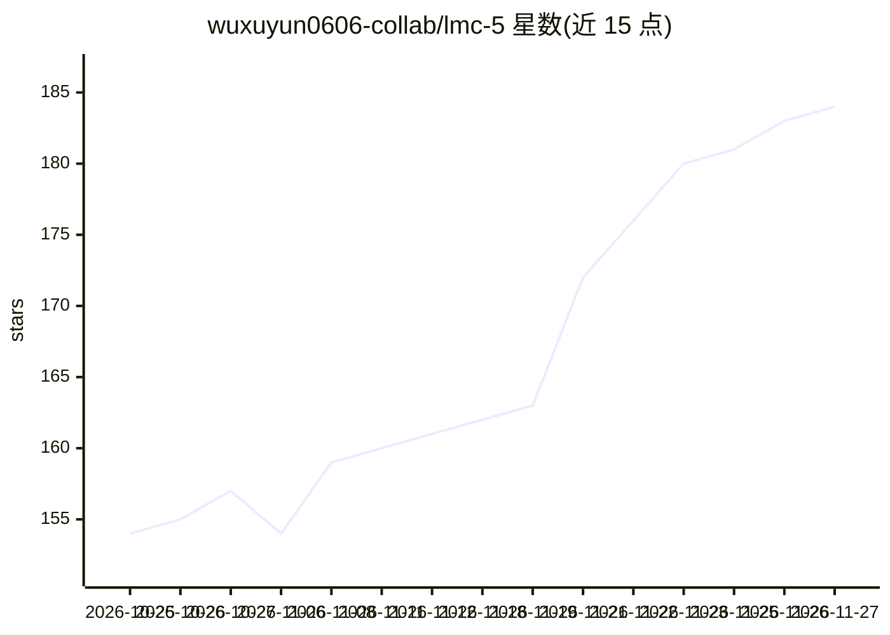

# wuxuyun0606-collab/lmc-5

⭐ 184 · Python · AGPL-3.0 · 推送 2026-11-22 · [GitHub](https://github.com/wuxuyun0606-collab/lmc-5) · 组织维护 · 中文 README

**给 LLM agent 提供跨会话长期记忆的五轴记忆架构实现**

LMC-5 将记忆按五个坐标组织：事件归属（X）、关联（Y）、当前事实（Z）、经验记录（E）与代谢衰减（M），提供 SQLite 与 PostgreSQL/pgvector 两套参考实现和多通道召回管线，支持两跳图扩展召回、LLM 撰写经验条目、夜间巩固任务与身份记忆保护。要求 Python 3.9+ 与 SQLite FTS5，提供 CLI（lmc5 add/list）与可运行示例，可部署为 VPS 7×24 服务。作者注明基准复现未覆盖 X/E/M 维度。

## 筛选速览

| 维度 | 判定 | 备注 |
|---|---|---|
| AI 角色 | `ai-ecosystem` | LLM/agent 周边工具 |
| 许可风险 | `viral` | AGPL-3.0 |
| 部署形态 | `None` |  |
| 模型依赖 | — | README 未给出锁定关系 |
| 硬件要求 | — | 无带数字的原话,不猜 |
| 安装摩擦 | `low` | 无编译、无系统依赖或容器化 |
| 成熟度 | — | 结构信号不足 |

## 能力要点

- 五轴坐标记忆模型：episode/关联/事实时效/经验/代谢
- SQLite 与 PostgreSQL/pgvector 双参考实现与多通道召回管线
- 两跳图扩展召回：经主题与事件边检索未出现查询词的记录
- 夜间巩固任务与身份记忆保护机制

## 适用场景

- 让 agent 在新会话中延续上次对话的上下文与偏好
- 管理会随时间变化的事实（如当前负责人）并保留历史
- 在长周期运维中检索跨会话的事故与决策链路

## 场景标签

`Agent 记忆` · 领域:Agent 开发

## 证据(README 行号)

> L3: LMC-5 gives AI agents long-term memory across conversations. Open a new chat and your agent can pick up where you le
> L93: **Local storage**　Point writes, searches and scheduled checks at the same SQLite file. Persistent deployment
> L95: **PostgreSQL and Claude Code**　Verify full-text search with a sample record, then connect session archival and reca

## 星数曲线

2026-10-25 154 → 2026-11-27 184（+30）

---
*卡片 v1 · prompt 1.4 · 生成 2026-11-26 · 置信度 mid · 依据 README sha `215d11ac52e7` · [字段定义](../../DATASET.md)*
