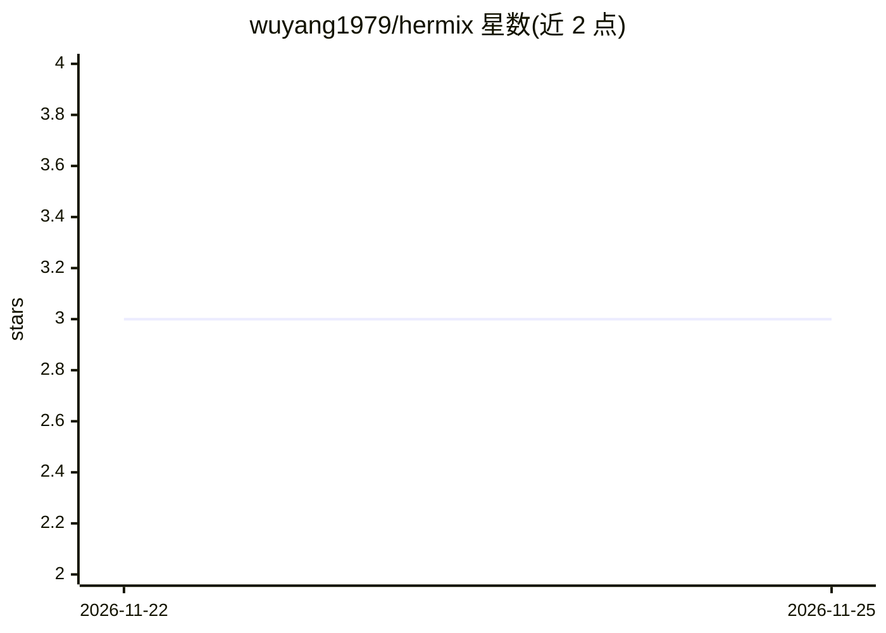

# wuyang1979/hermix

⭐ 3 · Python · MIT · 推送 2026-11-17 · [GitHub](https://github.com/wuyang1979/hermix) · [官网](https://hermix.cn) · 组织维护 · 中文 README

**可私有部署的企业级多智能体平台，接入企微/飞书/钉钉**

基于 Hermes Agent（Nous Research，MIT）二次开发的智能体平台，在内核之上新增中文场景适配、可视化控制台与多智能体编排。每个智能体拥有独立人格设定、知识库、技能（SKILL.md+脚本）、模型配置与消息通道；支持定时任务（自然语言生成 Cron）、多通道接入（企业微信/飞书/钉钉/Telegram/邮件）与运行监控。后端 Python 3.11+/FastAPI，前端 React，数据存 SQLite，全栈可跑在自建服务器上。核心商业代码不在本仓库。

## 筛选速览

| 维度 | 判定 | 备注 |
|---|---|---|
| AI 角色 | `ai-native` | 本体是模型或模型工具 |
| 许可风险 | `permissive` | MIT |
| 部署形态 | `library` | 以包/库形式分发 |
| 模型依赖 | local-ok | 支持本地模型 |
| 硬件要求 | — | 无带数字的原话,不猜 |
| 安装摩擦 | `low` | 无编译、无系统依赖或容器化 |
| 成熟度 | — | 结构信号不足 |

## 能力要点

- 多智能体各自独立，一个崩溃不影响其他
- SKILL.md 技能系统，智能体按任务自动加载技能
- 可视化控制台覆盖 Agent 管理、知识库、定时任务与费用统计
- 支持企业微信/飞书/钉钉/Telegram/邮件多消息通道

## 适用场景

- 在企业微信里直接对话多个分工不同的 AI 助手
- 定时巡检、抓数据、自动发报告
- 私有化部署，客户信息与对话记录留在自己服务器上
- 为不同角色配置不同模型以控制成本

## 场景标签

`多智能体` `AI 助手` `聊天机器人` · 领域:Agent 开发

## 证据(README 行号)

> L3: **可私有部署的 AI 智能体平台。**
> L5: 把大模型变成能真正干活的数字员工 —— 多个智能体各司其职、共享知识库、定时执行任务、通过企业微信 / 飞书 / 钉钉直接对话。整套系统跑在你自己的服务器上，数据不出内网。
> L31: 每个智能体是一个独立的 Hermes profile，拥有自己的：

## 星数曲线

2026-11-22 3 → 2026-11-25 3（+0）

---
*卡片 v1 · prompt 1.4 · 生成 2026-11-22 · 置信度 high · 依据 README sha `5633b33b12dc` · [字段定义](../../DATASET.md)*
