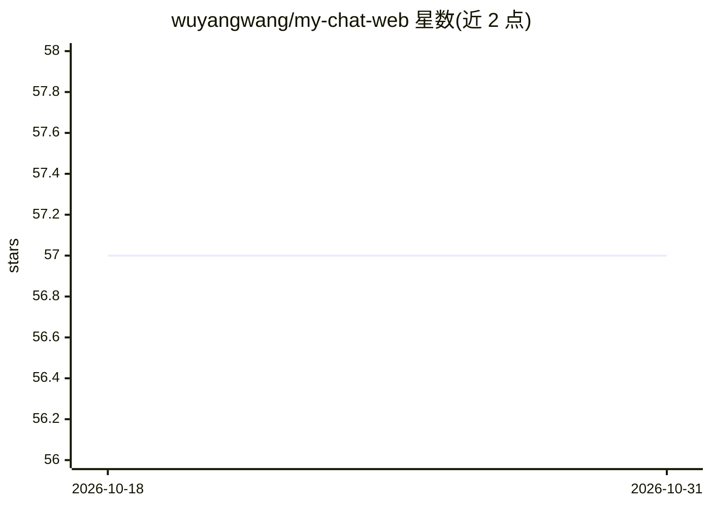

# wuyangwang/my-chat-web

⭐ 57 · JavaScript · MIT · 推送 2026-07-02 · [GitHub](https://github.com/wuyangwang/my-chat-web) · [官网](https://chat.handybox.top) · 个人维护 · 中文 README

**自部署的 AI 聊天网站：Cloudflare Workers AI 驱动聊天/画图/翻译**

基于 Next.js + TailwindCSS + shadcn-ui 的 AI 聊天 Web 应用，聊天 API 由 Cloudflare Workers AI 提供，仅支持部署到 Cloudflare Pages（通过 wrangler CLI，每天免费 10 万次请求）。内置聊天、图片生成（Stable Diffusion XL）、翻译（m2m100）三类功能，另可自带 API key 接入 DeepSeek、Gemini、Grok、OpenAI 及本地 Ollama。历史记录存于浏览器 localstorage（聊天/翻译各 500 条、图片 100 张），聊天默认携带 4 条上下文。面向想自行部署 chat 站点的开发者。

## 筛选速览

| 维度 | 判定 | 备注 |
|---|---|---|
| AI 角色 | `ai-native` | 本体是模型或模型工具 |
| 许可风险 | `permissive` | MIT |
| 部署形态 | `library` | 以包/库形式分发 |
| 模型依赖 | local-ok | 支持本地模型 |
| 硬件要求 | — | 无带数字的原话,不猜 |
| 安装摩擦 | `low` | 无编译、无系统依赖或容器化 |
| 成熟度 | — | 结构信号不足 |

## 能力要点

- Cloudflare Workers AI 提供聊天/图片生成/翻译三类模型
- 可自带 API key 接入 DeepSeek、Gemini、Grok、OpenAI、本地 Ollama
- 仅支持部署到 Cloudflare Pages，wrangler CLI 一键部署
- 聊天记录、图片、翻译历史存于本地 localstorage

## 适用场景

- 部署一个自己的 AI 聊天网站并绑定自己的域名
- 在 Cloudflare 免费额度内运行聊天、画图、翻译服务
- 本地开发时用 Ollama 或自有 key 的模型调试接口

## 场景标签

`聊天机器人` `图像生成` · 领域:对话与助手

## 证据(README 行号)

> L5: > 基于 nextjs + cloudflare pages 部署 + cloudflare workers ai 提供聊天 api
> L8: - 使用 cloudflare 提供的 workers ai 功能
> L22: - 图片生成 @cf/stabilityai/stable-diffusion-xl-base-1.0

## 星数曲线

2026-10-18 57 → 2026-10-31 57（+0）

---
*卡片 v1 · prompt 1.4 · 生成 2026-10-24 · 置信度 high · 依据 README sha `4c4660ad986c` · [字段定义](../../DATASET.md)*
