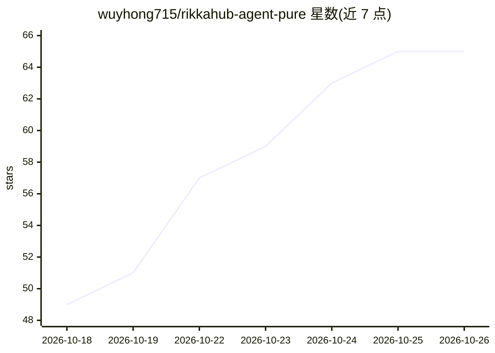

# wuyhong715/rikkahub-agent-pure

⭐ 65 · Kotlin · AGPL-3.0 · 推送 2026-10-25 · [GitHub](https://github.com/wuyhong715/rikkahub-agent-pure) · [官网](https://github.com/wuyhong715/rikkahub-agent-pure/releases/latest) · 个人维护 · 中文 README

**面向长时间无人值守运行的 Android 本地 AI agent 应用**

基于 RikkaHub/ExTV rikkahub-agent 的独立强化延续，为 Android 设备上的 LLM agent 增加七项默认关闭的强化层：按用途记账的用量账本与编排 token 预算、可搜索的按需工具目录（57 组约 180 个工具）、工具结果截断与模型主动压缩、可复用专家子 agent、Markdown 冷记忆、可串接的工作流与加密密钥库，以及无头路径自动批准的安全修复。支持 OpenRouter/Codex/Grok/Ollama/OpenAI 兼容端点与本地 LiteRT/AICore 模型，通过 Releases 下载 APK 或源码构建，构建需 JDK 17 与 Android SDK。

## 筛选速览

| 维度 | 判定 | 备注 |
|---|---|---|
| AI 角色 | `ai-native` | 本体是模型或模型工具 |
| 许可风险 | `viral` | AGPL-3.0 |
| 部署形态 | `None` |  |
| 模型依赖 | local-ok | 支持本地模型 |
| 硬件要求 | — | 无带数字的原话,不猜 |
| 安装摩擦 | `medium` | 含编译或系统依赖之一 |
| 成熟度 | `idea` | |

## 能力要点

- 用量账本与编排 token 预算，派发前检查超限拒派
- 工具目录按需搜索加载 schema（57 组约 180 个工具）
- 工具目录外：专家子 agent 各带模型/工具/命名空间/记忆
- Markdown 冷记忆按需读取，不占常驻上下文

## 适用场景

- 让手机上的 agent 长时间跑多步任务（重构代码、跑测试）
- 查看每次模型调用的成本与编排树，给运行设预算上限
- 组建多个专家子 agent 并行派发任务

## 场景标签

`Agent 框架` `工作流自动化` `GUI 自动化` · 领域:Agent 开发

## 证据(README 行号)

> L9: **RikkaHub Agent · Pure** is an independent, hardened continuation of the on-device Android agent from ExTV/rikkahub
> L192: **RikkaHub Agent · Pure** —— ExTV/rikkahub-agent（其上游为 rikkahub/rikkahub）的**独立强化延续**（2026-10-07 起已脱离 fork 网络），**面向长

## 星数曲线

2026-10-18 49 → 2026-10-26 65（+16）

---
*卡片 v1 · prompt 1.4 · 生成 2026-10-24 · 置信度 high · 依据 README sha `cae2ccd59775` · [字段定义](../../DATASET.md)*
